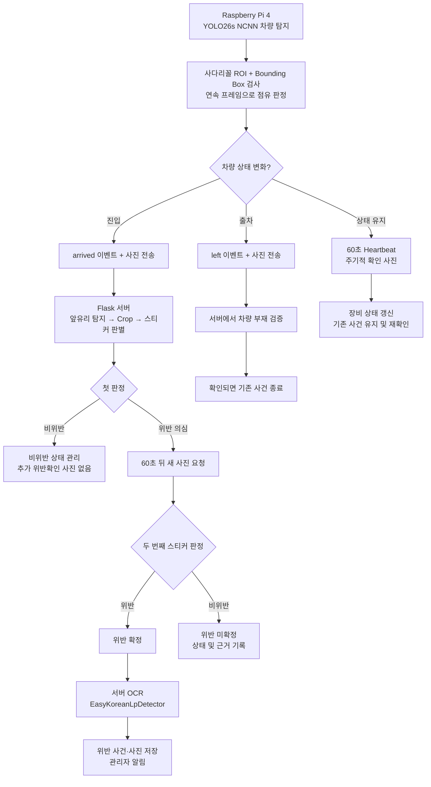

# Parking Guardian — AI 아키텍처 최종 설계안

> **문서 성격:** 구현 방향 및 검증 계획  
> **상태:** 최종 권장 설계안 (현재 코드에 모두 구현되었다는 의미는 아님)  
> **대상 하드웨어:** Raspberry Pi 4  
> **범위:** 2026-10-24에 **MVP 범위**로 정리했다. 10절이 MVP 결정, 12절이 MVP에서 뺀 추후 개선 목록이다. 1~9절은 설계 방향이며 MVP 밖인 부분은 각 절에 "(MVP 제외)"로 표시했다.  
> **2026-10-25 변경:** 번호판 OCR 은 MVP 에서 **제거**됐다(`docs/adr/0017`). 이 문서의 OCR 관련 절(서버 OCR 파이프라인, `plate_*`, `OCR_FAILED`, 12절의 OCR 개선 항목)은 당시 설계의 기록이며 현재 코드에는 없다. 사진 저장은 S3 Adapter 가 추가됐다(`docs/adr/0016`). 그 외 Pi 점유 판정, 이벤트 전송, Heartbeat, 사건 묶기는 그대로다.

## 1. 설계 목표

Parking Guardian은 장애인 주차구역의 차량 점유를 감지하고, 장애인 스티커 여부를 판별하여 위반 사건을 관리하는 시스템이다.

다음 세 가지를 우선한다.

1. **정확성:** 목표 주차구역만 감지하고, 스티커 판정 오류에 따른 잘못된 위반 확정을 줄인다.
2. **안정성:** 네트워크 장애·중복 요청·AI 추론 실패가 잘못된 사건 생성 또는 종료로 이어지지 않도록 한다.
3. **효율성:** 불필요한 사진 전송과 서버 AI 추론을 줄이고 개선 효과를 수치로 측정한다.

## 2. 최종 아키텍처

**역할 분리:** Raspberry Pi는 *언제 사진을 보낼지* 결정하고, 서버는 *위반인지* 판단하며 사건을 관리한다.

## 3. 기능별 결정 사항

| 항목 | 최종 권장안 |
|---|---|
| Pi 차량 탐지 | YOLO26s (COCO 사전학습, NCNN) |
| 대상 주차구역 구분 | 4점 사다리꼴 ROI, 박스 아랫변 중심·겹침 비율·크기 검사 |
| 차량 탐지 간격 | 초기값 5초 |
| 차량 진입 판정 | 연속 3프레임 점유 |
| 차량 출차 판정 | 연속 6프레임 비점유 |
| 사진 전송 | 진입·출차 이벤트 및 주기적 확인 사진 |
| Heartbeat | 60초마다 전송 |
| 위반 확정 | **서로 다른 사진에서 위반 2회 연속 확인** |
| 추가 확인 사진 | 첫 스티커 판정이 위반 의심일 때 약 60초 후 요청 |
| OCR | **서버에서 위반 확정 시 실행**; 차량 변경 의심 시 필요에 따라 추가 검토 |
| 추론 서비스 | 우선 기존 Flask + OCR Adapter 유지 |
| FastAPI 분리 | 후속 Phase에서 별도 성능 측정과 함께 추진 |
| 사건 관리 | 동일 주차 사건 중복 생성·알림 방지 |
| 판정 불가 | (MVP 제외) 판정값은 `violation` / `permitted` / `no_vehicle` 셋을 유지한다. 추론 실패는 지금처럼 503을 돌려주고 사건 판정을 건너뛴다. `UNKNOWN`은 12절 |

위 수치(5초·3프레임·6프레임·60초)는 **초기 운영 및 실험 기준**이다. 실제 Raspberry Pi 4 촬영 조건에서 조정해야 한다.

## 4. Raspberry Pi 4에서의 처리

### 4.1 ROI 점유 판단

- 실제 카메라의 `sample_c`와 같은 구도를 기준으로 목표 주차면의 4점 ROI를 정한다.
- 화면에 탐지된 모든 차량을 점유로 간주하지 않는다.
- YOLO 탐지 박스별로 아랫변 중심이 ROI 안에 있는지, ROI와 얼마나 겹치는지, 충분한 크기인지 검사한다.
- 좌우 화면 끝에서 잘린 좁은 박스를 제외하는 규칙도 적용한다.
- ROI 좌표 및 기준값은 설정으로 관리하며 미리보기 도구로 검증한다.
- 제안된 겹침 기준 초기값은 진입 **0.30**, 이탈 **0.15**이다. 실측 영상에서 재조정한다.

### 4.2 연속 프레임 검사

- 5초마다 분석한다고 가정하면, 차량 감지 3회 연속에서 진입을 확정한다.
- 이미 점유 중이라면 비점유 6회 연속에서 출차를 확정한다.
- 이는 **점유 상태의 연속성**을 확인하는 규칙이며, 동일 번호판의 차량임을 증명하지 않는다.

### 4.3 이벤트와 Heartbeat

- `arrived`: 진입 확인 후 사진과 이벤트 전송
- `left`: 출차 확인 후 빈 주차면 사진과 이벤트 전송
- 주차 중: 60초마다 Heartbeat; 10분(설정)마다 `refresh` 확인 사진 전송. 서버 응답이 `violation_pending` 이면 60초 뒤 `confirm` 사진 전송
- 비어 있는 동안: Heartbeat만. 사진 없음(카메라 정렬 확인용 저빈도 사진은 MVP 제외)

Heartbeat는 MVP에서 지금 그대로다(인증 키로 장비를 알고 서버가 받은 시각만 기록). 점유 상태, 마지막 정상 추론 시각, 탐지 프로세스 상태 필드는 MVP 제외(12절).

## 5. 서버 AI 판정과 OCR

1. `arrived` 사진을 수신한다.
2. 기존 앞유리 탐지 모델로 앞유리를 찾고 Crop한다.
3. 스티커 모델로 판정한다.
4. 첫 결과가 **비위반**이면 위반 확정용 재촬영을 요청하지 않는다.
5. 첫 결과가 **위반 의심**이면 60초 뒤 **새 사진**을 받는다. 서버 응답 형식은 바꾸지 않는다. Pi가 `result: violation_pending` 을 보고 `confirm` 사진을 찍어 보낸다.
6. 두 번째 사진에서도 위반이면 위반 1건을 확정한다.
7. 확정된 위반에 대해 EasyKoreanLpDetector OCR을 서버에서 실행하고 가능한 경우 번호판 결과를 사건에 연결한다.
8. OCR 실패와 위반 기록·관리자 알림 실패는 분리해 처리한다. OCR이 실패했다고 위반 기록이나 알림이 사라지지 않아야 한다.

**주의:** 같은 사진을 다시 추론하는 것은 독립적인 두 번의 확인이 아니다. 두 판정은 새로운 촬영 이미지로 수행한다. 2회 판정도 모든 오탐을 방지하지는 못한다.

**OCR 수집 범위:** 정상 주차 차량의 번호판을 매번 인식·보관하지 않는다. 위반 확정 시점을 기본 OCR 실행 시점으로 정하며, 차량 교체 의심 시 추가 OCR은 별도 정책 및 개인정보 검토를 거친다.

## 6. 장애 및 예외 처리

**MVP에 들어가는 것은 세 가지뿐이다.** ① 끊김 판정: 마지막 신호(사진 또는 Heartbeat 중 늦은 것) 기준으로 `EPISODE_GAP_MINUTES`(10분)를 재고 기존처럼 `SIGNAL_LOST` 로 종료한다. ② 추론 실패: 지금처럼 503을 돌려주고 사건 판정을 건너뛴다. ③ OCR 실패: 번호판을 비워 두고 위반 기록·알림과 분리한다. 아래 표의 나머지 행과 6.1, 6.2는 설계 방향으로 남기되 **MVP 제외**(12절)다.

| 상황 | 권장 대응 |
|---|---|
| 사진이 드물게 도착함 | 사진 간격이 아니라 **Heartbeat 기준**으로 연결 장애 판정 |
| Heartbeat 누락 | 장비 연결 이상 기록. 차량 출차로 단정하지 않음 |
| 네트워크 복구 | Pi의 점유 이력·오프라인 중 기록한 이벤트를 재동기화하고 기존 사건의 지속 여부 검증 |
| 복구 후 중간 차량 교체 여부 불명 | 같은 사건이라고 단정하지 않고 `확인 필요` 상태로 관리 |
| 동일 요청 재전송 | 고유 이벤트 ID로 멱등 처리하여 중복 사건·알림 방지 |
| 이벤트 순서 뒤바뀜 | 장비별 `seq`·촬영 시각을 사용하고 누락 구간은 복구/재동기화; 단순히 낮은 `seq`를 무시하지 않음 |
| Pi는 차량 있음, 서버는 앞유리 미탐지 | `UNKNOWN` 처리, 재촬영/추가 검증. 곧바로 `no_vehicle`로 판단하지 않음 |
| OCR 실패 | 번호판 `UNKNOWN`으로 기록하고 위반 처리와 분리 |
| 짧은 출차 후 재진입 | Pi 점유 판정만으로 차량 동일성을 확정할 수 없음. 주기적 사진 및 불일치 검토 정책 적용 |
| 장비의 탐지 프로세스 중단 | Heartbeat 자체뿐 아니라 마지막 실제 추론 시각을 검사 |

### 6.1 연결 장애와 사건 종료를 분리

연결이 끊겼다는 사실은 **차량이 떠났다는 사실이 아니다.** 사건을 즉시 종료하는 대신 `signal_lost_at` 등의 장애 정보를 기록한다. 연결이 복구되면 촬영 시각과 Pi의 로컬 상태 이력 등을 확인해 계속되는 사건인지, 종료할 사건인지 결정한다.

장기 미복구 사건의 정리 기간(예: 24시간)은 정책값으로 두되, 자동 종료가 실제 출차를 의미하는 것으로 표시되지 않도록 별도 종료 사유를 둔다.

### 6.2 장애 모니터링

초기에는 현재의 화면 조회 시 온라인 여부 계산(`MACHINE_ONLINE_SECONDS`)을 활용할 수 있다. **장애를 능동적으로 알리려면** 추후 별도 주기 실행 작업이 필요하다. Heartbeat 누락을 검사하는 방식과 기존의 사진 간격 기반 `EPISODE_GAP_MINUTES` 판정은 충돌하지 않도록 수정한다.

## 7. 단계별 구현 및 성능 검증

| 단계 | 작업 | 측정·확인 포인트 |
|---|---|---|
| Before | 기존 1분 사진 전송 방식 유지 | 사진 수, 트래픽, AI 추론 시간, 서버 CPU·메모리, 알림 지연 |
| 1 | Pi의 YOLO26s NCNN + ROI + 연속 프레임 | 점유 오탐률·미탐률, 진입·출차 지연, Pi CPU·메모리 |
| 2 | 이벤트 전송, Heartbeat, 재전송·장애 처리 | 사진 전송량, 네트워크 복구, 사건 중복·누락 |
| 3 | 조건부 2회 위반 확인, 서버 OCR Adapter | 스티커 오탐, OCR 성공률, 추가 추론 비용 |
| After | 동일 조건에서 개선 구조 재측정 | Before/After 성능 비교 및 개선율 |
| 후속 | 1회/2회 확정 A/B 실험 및 FastAPI 분리 | 오탐률·지연·비용 차이, 서비스 분리 자체의 효과 |

**실험 원칙:** 변경을 한꺼번에 적용해 성능 원인을 혼동하지 않는다. 실제 측정값과 추정치를 구분하고, 가능하면 동일한 이미지·영상 및 부하 조건으로 비교한다.

## 8. 결정 및 유보 사항

### 지금 채택

- Pi에서 차량 점유를 확인하고 사진 전송 시점을 결정한다.
- 서버에서 앞유리/스티커를 판별하고 두 번의 연속 위반 판정 후 사건을 확정한다.
- 서버 OCR은 확정 위반에 한해 우선 적용한다.
- 기존 Flask Adapter 구조를 유지한다.
- Heartbeat는 구현한다. 이벤트 ID·순서 정보, 복구 시 동기화는 MVP 제외(12절).

### 향후 검토

- 위반 **1회 확정** 방식은 운영 기본값이 아니라 비교 실험으로 평가한다.
- OCR 신뢰도에 따른 추가 검증 및 차량 교체 식별 고도화
- FastAPI AI 서비스 분리 및 독립 확장
- 능동 장애 알림 스케줄러
- 12절의 MVP 제외 항목 전체

## 9. 관련 의사결정 문서

- **ADR 0004:** 위반 2회 연속 확정 규칙
- **ADR 0006:** 이미지 압축에 따른 스티커 탐지 정확도 영향
- **ADR 0007:** 현재 Adapter 구조
- **ADR 0010:** 촬영 주기 최적화 및 측정 우선 원칙
- **ADR 0011:** OCR 도입·개인정보 및 보조 신호 범위
- **ADR 0014 (제안):** 이벤트 기반 사진 전송과 Heartbeat → `docs/adr/0014-event-based-capture-and-heartbeat.md` 작성됨 (2026-10-20)
- **ADR 0015 (제안):** 서버 OCR 도입 범위 → `docs/adr/0015-server-ocr-on-confirmed-violation.md` 작성됨 (2026-10-20)

> **최종 결론:** `Pi 차량 점유 감지 → 이벤트 기반 사진 전송 → 서버 스티커 2회 판정 → 위반 확정 시 OCR → 사건 저장·알림`을 우선 구현한다. MVP(10절)는 기존 구조를 최소로 바꿔 이 흐름을 연결하는 것까지이고, 장애 복구와 이벤트 재처리는 12절의 추후 개선이다.

---

## 10. MVP 범위 결정 (2026-10-24)

위 1~9절의 설계 방향은 유지하되 **이번 구현은 MVP다.** 사용자 결정(2026-10-24): 설계 과정에서 기능과 예외 처리가 계속 늘어 시스템이 복잡해지는 것을 피한다. 새 기능이나 복잡한 로직을 임의로 추가하지 않고, 기존 구조를 최대한 활용해 최소 변경으로 핵심 기능을 연결한다. 복잡한 예외 처리, 추가 판정 상태, 영속 큐, 고급 장애 복구는 MVP 뒤 별도 개선 단계(12절)에서 검토한다.

### 10.0 구현 상태 (2026-10-24)

10.3~10.6 을 그대로 구현했다. 사용자 조건 둘을 반영했다: ① `left` 는 서버가 `no_vehicle` 로 판정했을 때만 즉시 종료하고 `permitted` 는 3회 규칙 그대로, ② 이벤트 큐 없이 기존 행 잠금과 조건부 UNIQUE Index 를 유지. Before/After 측정 결과는 `docs/measurements/README.md`(사진 −91%, 추론 시간 −94%, 위반·알림 수와 알림 지연은 같음). OCR 은 샘플 3장 중 1장을 높은 신뢰도로 잘못 읽었다(같은 문서 "OCR 비용"). Pi 4 실측은 아직 없다(11절).

### 10.1 MVP에 들어가는 것

| 영역 | 핵심 기능 |
|---|---|
| Pi | YOLO26s NCNN 차량 탐지, 사다리꼴 ROI, 연속 프레임(진입 3 / 출차 6), 이벤트 기반 사진 전송(`arrived`, `confirm`, `refresh`, `left`), 매분 Heartbeat |
| 서버 | 기존 2회 연속 위반 확정 규칙 유지. 위반 확정 시 OCR(EasyKoreanLpDetector) Adapter |
| 판정값 | `violation`, `permitted`, `no_vehicle` 셋 그대로. **`UNKNOWN`은 추가하지 않는다.** 추론 실패는 지금처럼 503을 돌려주고 사건 판정을 건너뛴다 |

### 10.2 2026-10-20 미결 사항의 MVP 결론

| # | 결정할 것이었던 것 | MVP 결론 |
|---|---|---|
| 1 | `UNKNOWN` 판정의 카운터 영향 | **추가하지 않는다**(사용자 결정). 판정값 셋 유지. 추론 실패는 503 + 건너뛰기 |
| 2 | Pi가 보내는 필드 | 사진 요청에 `event` 하나만 추가한다(선택 필드. 없으면 지금과 같은 1분 전송 사진으로 처리하므로 `scripts/send_detection.py` 는 그대로 동작). Heartbeat는 지금 그대로(시각만). `seq`, `event_id`, `occupied`, `last_inference_at`, `detector_ok` 는 MVP 제외 |
| 3 | 순서 보장 주체 | Pi가 하나씩 동기 전송한다(지금 `pi_client.py` 구조 그대로). 큐가 없으니 순서가 뒤바뀔 길이 없다. 서버 변경 없음 |
| 4 | 오프라인 중 쌓인 이벤트의 시각 기준과 큐 크기 | 영속 큐를 두지 않으므로 해당 없음. 전송 실패는 로그만 남기고, 주차 중이면 다음 `refresh` 때 사진이 다시 간다. 사건 묶기의 시각 기준은 서버 시각 유지 |
| 5 | `left` 사진에서 서버가 차량을 본 경우 | 특별 처리 없음. 다른 사진과 같은 판정 규칙을 탄다(위반이면 `violation_ongoing`). "서버가 판사"라는 원칙은 그대로다 |

2~5번의 세부는 2026-10-24에 권장안으로 적은 것이다. 사용자 확인 뒤 `docs/design/API.md` 에 반영한다.

### 10.3 서버에서 바꾸는 것 (최소 변경 세 곳)

| 무엇 | 지금 | MVP 변경 | 이유 |
|---|---|---|---|
| 끊김 판정의 기준 시각 | 마지막 사진(`machine.last_detection_at`) | 마지막 **신호**(사진 또는 Heartbeat 중 늦은 것). `EPISODE_GAP_MINUTES`(10분)와 `SIGNAL_LOST` 종료는 그대로 | 이벤트 모드에서는 주차 중 사진이 10분마다만 온다. 사진 기준이면 정상 주차 중에도 `SIGNAL_LOST` 가 난다. Heartbeat가 매분 오는 동안은 장비가 살아 있는 것이다. `record_verdict()` 의 `previous` 계산 한 줄 |
| `left` 사진의 종료 규칙 | 비위반 3회 연속이면 종료 | `event=left` 이고 판정이 비위반이면 **1회로 바로 종료**(종료 사유는 지금처럼 `VEHICLE_LEFT` / `STICKER_DETECTED`). `left` 가 아닌 사진은 3회 규칙 그대로 | 이벤트 모드에서는 `left` 뒤에 사진이 더 오지 않는다. 3회를 기다리면 사건이 열린 채 남아 다음 차량의 `arrived` 가 같은 사건에 묶인다. Pi는 이미 비점유 6프레임(30초)을 확인한 뒤 `left` 를 보낸다 |
| OCR | 없음 | `backend/app/adapters/ocr.py` Adapter. 위반이 **확정된** 사진(사진 저장 뒤, 알림 전)에만 실행. `Violation.plate_number`, `plate_confidence` 두 컬럼. 실패하면 비워 두고 이력 한 줄(사진 저장 실패와 같은 방식). `OCR_ENABLED` 기본 false(테스트와 모델 없는 환경) | ADR 0015 |

두 번째 확정 사진 요청은 **응답 형식을 바꾸지 않는다.** Pi가 응답의 `result: violation_pending` 을 보고 60초 뒤 `confirm` 사진을 찍어 보낸다. 서버는 `confirm` 을 일반 사진으로 처리하면 기존 2회 규칙이 그대로 동작한다.

### 10.4 Pi에서 바꾸는 것

`PG_MODE=event` 를 추가한다. 구현과 측정 때는 기본이 `interval`(지금의 1분 전송)이었고, 측정이 끝난 2026-10-24에 **운영 기본값을 `event` 로 바꿨다.** `interval` 은 삭제하지 않고 비교·성능 측정용 보조 모드로 남긴다. event 모드의 동작:

1. 5초마다 저해상도 프레임을 받아 `vehicle_detector.py` 로 점유를 판정한다.
2. 비점유 → 점유 3프레임 연속: `arrived` 사진 전송. 응답이 `violation_pending` 이면 60초 뒤 `confirm` 사진 전송.
3. 점유 중: 60초마다 Heartbeat, 10분마다 `refresh` 사진.
4. 점유 → 비점유 6프레임 연속: `left` 사진 전송(빈 자리).
5. 비점유 중: 60초마다 Heartbeat만. 사진 없음.
6. 전송 실패: 로그만 남긴다. 재시도 큐 없음.

LED는 지금처럼 응답 `result` 로 켜고 끈다. `arrived` 전송에 실패하면 다음 `refresh`(10분)까지 위반을 모르는 것은 MVP에서 감수한다.

### 10.5 정책값 (설정값, 초기값)

| 설정 | 초기값 | 위치 |
|---|---|---|
| 탐지 간격 / 진입 / 출차 프레임 | 5초 / 3 / 6 | Pi `PG_DETECT_INTERVAL`, `PG_ENTER_FRAMES`, `PG_LEAVE_FRAMES` |
| `confirm` 대기 | 60초 | Pi `PG_CONFIRM_DELAY` |
| `refresh` 간격 | 10분 | Pi `PG_REFRESH_INTERVAL` |
| Heartbeat | 60초 | Pi `PG_HEARTBEAT_INTERVAL` |
| 끊김 종료 | 10분(기존) | 서버 `EPISODE_GAP_MINUTES` |
| 온라인 판정 | 300초(기존) | 서버 `MACHINE_ONLINE_SECONDS` |
| OCR | 꺼짐 | 서버 `OCR_ENABLED`, 모델 경로 |

2026-10-20의 10.2에 있던 "확정 대기 만료", "의심 3분 / 확정 5분", "장기 미복구 정리", "OCR 재실행과 번호판 보존 기간", "Pi 큐"는 12절로 옮겼다.

### 10.6 바뀌는 데이터

- 위반: `plate_number`, `plate_confidence` 두 컬럼. `signal_lost_at`, `plate_status`, `review_required`, 새 종료 사유는 MVP 제외.
- 장비: 변경 없음.
- 새 테이블: 없음.

### 10.7 측정 준비

- `PG_MODE=interval` 이 남으므로(기본값은 event 로 바뀌었지만 모드는 유지) Before(1분 전송) 측정은 MVP 연결 뒤에도 같은 코드로 할 수 있다. 한꺼번에 바꾸지 않는다는 7절 원칙은 모드 전환으로 지킨다.
- 7절 1단계의 "점유 오탐률·미탐률"은 **정답을 붙인 Pi 카메라 프레임**이 있어야 나온다. 측정 환경 준비에 "빈 자리, 정상 주차, 앞으로 당겨 댄 차, 경계에 걸친 차, 옆 칸만 찬 경우, 야간 프레임 수십 장 수집과 라벨링"을 넣는다.
- 7절 3단계의 "추가 추론 비용"은 Before도 2회 확정이므로 "위반 1건당 사진 수"로 적어 Before/After에서 같은 지표가 되게 한다.

## 11. Raspberry Pi 4에서 검증해야 할 것 (실측 없음)

> 2026-10-24: PC에서 할 수 있는 검증은 했다(`docs/measurements/PC_VERIFICATION.md`). 가상 점유 시나리오로 이벤트 전송과 서버 연동, 샘플 사진 3장으로 YOLO26s(.pt, NCNN)와 ROI 판정, 사진 프레임 → 탐지 → 상태 기계 → 서버 전체 경로. 아래 항목은 여전히 Pi 4가 있어야 한다.

PC에서 확인한 것과 Pi에서 확인하지 못한 것을 구분한다.

| 항목 | PC에서 확인 | Pi 4에서 확인할 것 |
|---|---|---|
| YOLO26s NCNN 480 속도 | 217ms (PC CPU) | 1프레임 시간. 5초 간격이면 1초 안쪽이어야 한다 |
| 메모리 | 미측정 | 탐지 프로세스 RSS, `pi_client.py` 와 함께 돌릴 때 여유 |
| ROI 판정: 차량 있음 | sample_c 신뢰도 0.92~0.94, 겹침 49~50% → 인정 | 실제 카메라 구도에서 같은 결과인지 |
| ROI 판정: 빈 자리 | **없음** (sample_c 각도 빈 자리 사진이 없다) | 빈 자리에서 "없음"이 나오는지, 바닥 무늬·그림자 오탐 |
| ROI 판정: 옆 칸 차량 | sample_b(다른 각도)에서만 제외 확인 | sample_c 각도에서 옆 칸 차가 어떻게 잘려 보이고 제외되는지 |
| 기준값 | 사진 3장에서 역산 (0.30 / 0.15 / 5% / 35% / 0.40) | 수십 장 분포로 다시 정한다 |
| lores 프레임 | 미확인 | Picamera2 lores YUV420 → BGR 변환, ROI 좌표가 4:3 원본과 같은지 |
| 야간 | 미확인 | 야간 조명에서의 탐지 신뢰도 |
| 서버 모델 | Pi 카메라 사진 미확인 | 앞유리·스티커 모델이 Pi 카메라 사진에서 동작하는지 (기존부터 미확인) |
| OCR | 프로젝트 사진 4장 정확 | Pi 카메라 사진과 야간에서의 인식률 |

## 12. 추후 개선 사항 (MVP 이후 별도 단계)

2026-10-20 설계에는 있었지만 MVP(10절)에서 뺀 것이다. 필요가 확인되면 ADR을 새로 쓰고 하나씩 넣는다. MVP 구현 중에는 이 목록의 것을 임의로 추가하지 않는다.

| 항목 | 내용 | 원래 위치 |
|---|---|---|
| `UNKNOWN` 판정 | Pi는 점유인데 앞유리가 없을 때 등. 카운터를 바꾸지 않고 이력만, 확정 사진이 UNKNOWN이면 재요청 최대 N회 | 3절, 6절, 10-20 미결 1 |
| 이벤트 ID와 순서 | `event_id` 멱등 처리, 장비별 `seq` | 6절, 10-20 미결 3 |
| 영속 큐 | 오프라인 중 이벤트를 SD에 보관하고 복구 때 순서대로 전송. 사건 묶기 시각을 `detected_at` 기준으로, 오래된 위반 사진은 알림 생략. 큐 크기 | 10-20 미결 4 |
| Heartbeat 확장 필드 | `occupied`, `last_inference_at`, `detector_ok`. 탐지 프로세스만 죽은 경우 감지 | 4.3, 6절 |
| 연결 장애와 사건 종료의 분리 | `signal_lost_at` 기록, 복구 때 Pi 점유 상태로 이어 갈지 결정, 장기 미복구 정리 기간과 별도 종료 사유, 의심 3분 / 확정 5분 | 6.1, 10-20 10.2 |
| 능동 장애 알림 | Heartbeat 누락을 검사하는 주기 작업 | 6.2 |
| `left` 사진에서 차량이 보일 때 | 사건을 닫지 않고 확인 필요 표시 + 60초 뒤 재촬영 | 10-20 미결 5 |
| 확인 필요(`review_required`) | OCR 불일치, 차량 교체 의심, 복구 후 불명 | 5절, 6절, ADR 0015 |
| OCR 재실행과 보존 기간 | `refresh` 위반 사진 OCR 재실행과 비교, `plate_status` 컬럼, 번호판 보존 기간과 조회 권한 | ADR 0015 결정 3·5 |
| 확정 대기 만료 | 끊김 판정과 분리된 "확정 대기는 N분 뒤 초기화" 설정값 | 10-20 10.2 |
| 빈 자리 저빈도 사진 | 카메라 정렬·작동 확인용 | 4.3 |
| 1회 확정 A/B, FastAPI 분리 | 비교 실험, 추론 서비스 분리 효과 측정 | 7절 후속, 8절 |
| OCR 정확도 | 원본 파이프라인의 차량 탐지(YOLO26s) → 차량 crop 안에서 번호판 탐지 단계 복원, 여러 crop 투표, 신뢰도 높은 오독 대책. sample_c 를 `153보2726` 으로 잘못 읽은 것(실제 `153부2726`)이 계기 | 2026-10-24 측정, ADR 0015 |
