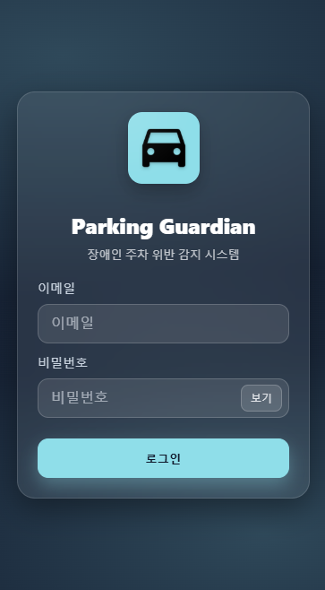
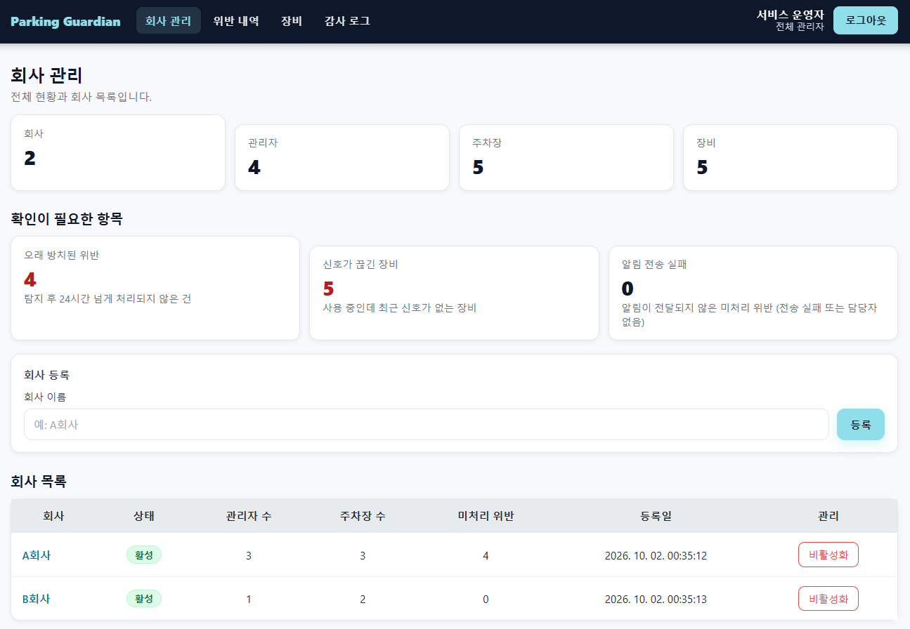
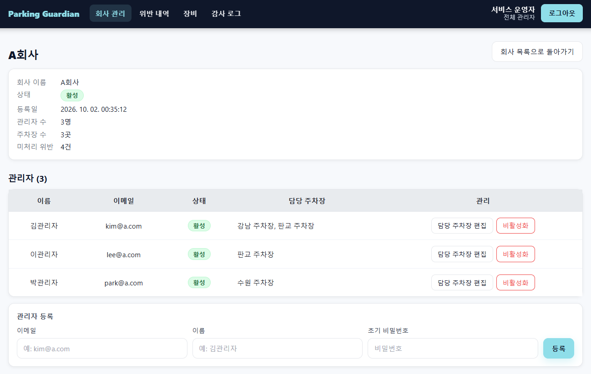
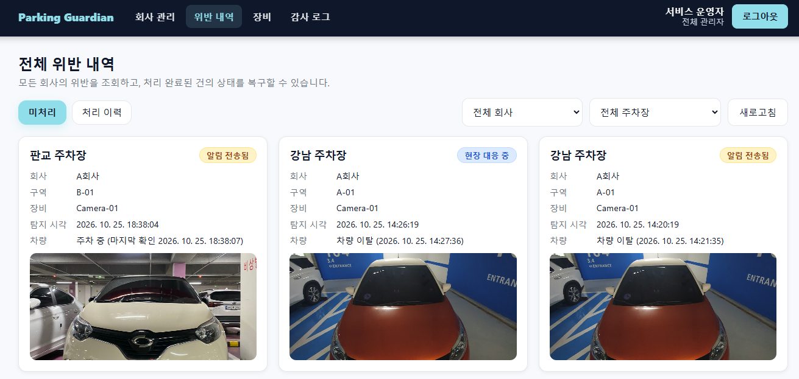
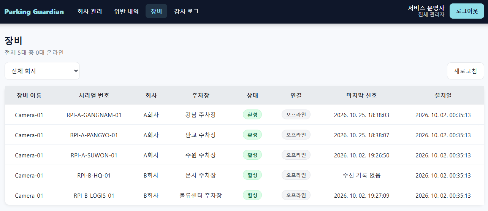
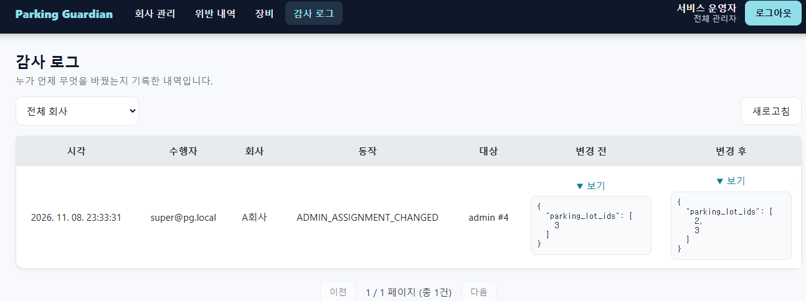
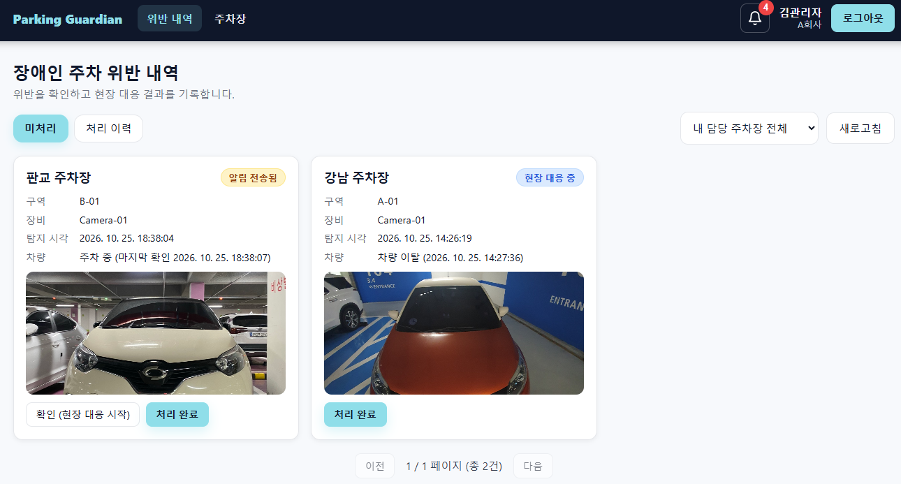
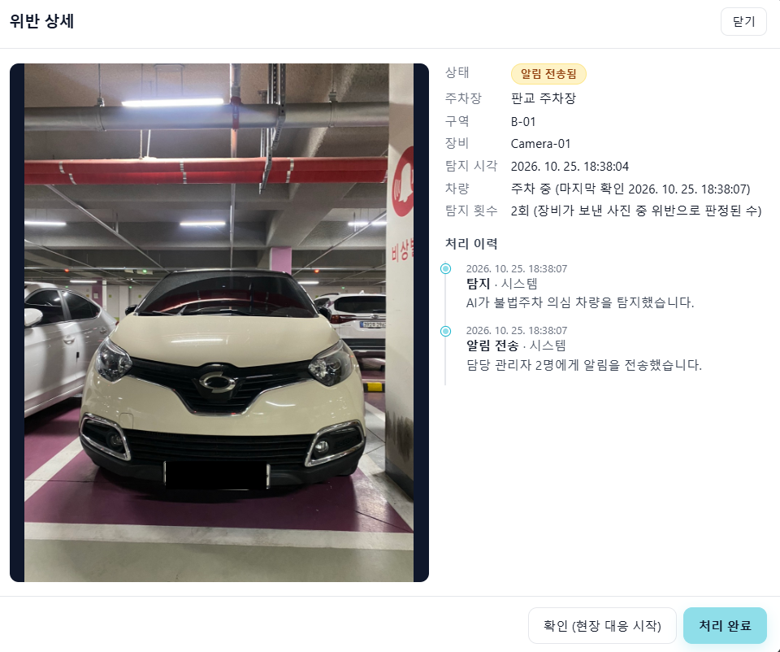
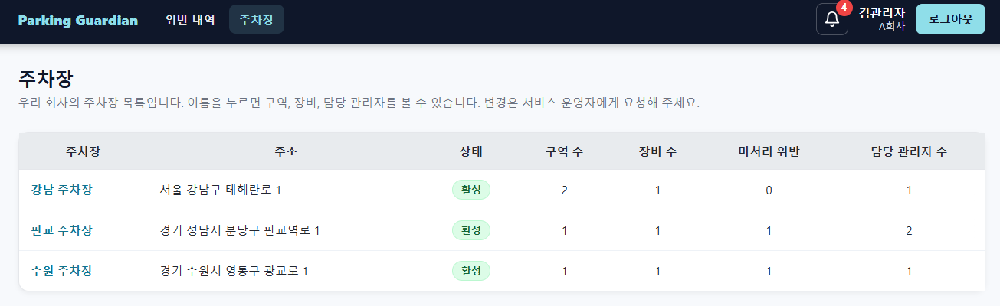
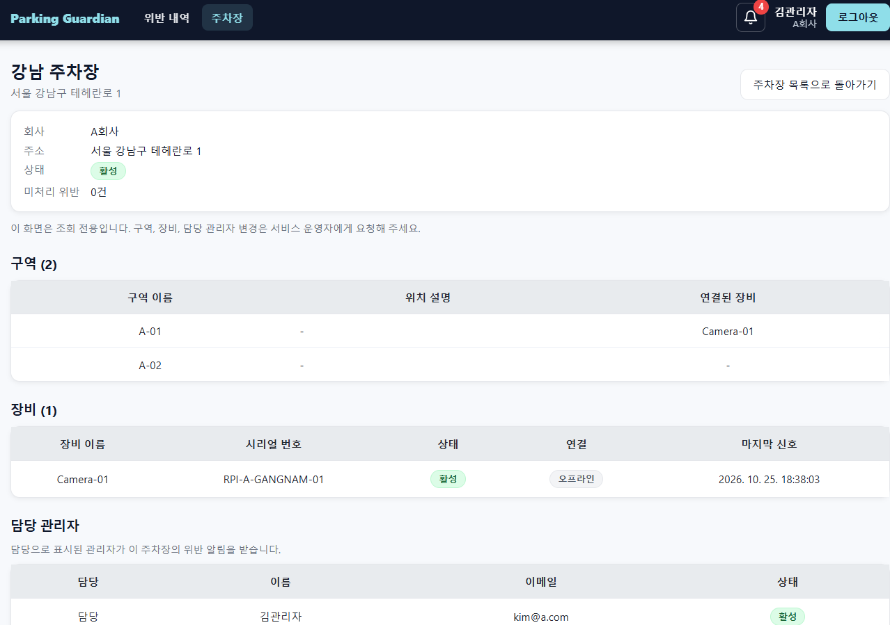

# Parking Guardian

장애인 전용 주차구역의 불법주차를 탐지하고 관리하는 Multi-Tenant 웹 서비스입니다. 주차구역을 지켜보는 장비(Raspberry Pi)가 사진을 서버로 보내면, 서버가 AI로 앞유리와 장애인 주차 스티커를 판정해 위반 차량을 기록하고 담당 관리자에게 알립니다.

## 프로젝트 소개

### 해결하려는 문제

장애인 전용 주차구역은 일반 차량이 무단으로 세우는 일이 잦지만, 사람이 일일이 순찰하며 확인하기는 어렵습니다. 이 서비스는 카메라가 찍은 사진으로 "장애인 주차 스티커가 없는 차량이 세워져 있는가"를 자동 판정하고, 확정된 위반만 관리자에게 전달합니다.

### 개발 배경

대학 캡스톤 프로젝트로 만든 단일 서버 프로그램을 출발점으로, 여러 고객 회사가 함께 쓰는 클라우드 서비스로 단계적으로 다시 만들고 있는 프로젝트입니다. 원본 코드는 Git 태그 `legacy-capstone`에 있습니다. 구조는 세 단계로 발전했습니다.

| 단계 | 구조 | 상태 |
|---|---|---|
| Prototype | Flask API와 AI 추론이 한 프로세스 안에서 동작 | 태그 `prototype-v1` |
| Phase 1 | API와 AI 추론 서비스를 분리하고 HTTP로 동기 호출 | 구현 완료 |
| Phase 2 | S3와 SQS FIFO 큐로 사진 접수와 AI 판정을 분리하는 비동기 구조 | 구현 완료, 현재 배포 기준 |

## 주요 기능

모든 항목은 이 저장소의 코드에서 확인한 것입니다.

| 영역 | 기능 |
|---|---|
| 인증과 권한 | JWT 로그인(Access Token + httpOnly Refresh 쿠키). 역할은 `SUPER_ADMIN`(서비스 운영자)과 `COMPANY_ADMIN`(고객 회사 관리자) 두 가지 |
| Multi-Tenant | 회사가 Tenant입니다. 회사 관리자는 자기 회사 데이터만 조회하고, 다른 회사 자원은 존재 여부도 노출되지 않습니다(404/403) |
| 운영자 기능 | 회사, 주차장, 구역, 장비 등록과 수정, 장비 키 재발급, 회사 관리자 계정 생성과 담당 주차장 배정, 감사 로그 조회, 운영 현황 요약 |
| 장비 연동 | 장비 키(`X-Device-Key`)로 인증하는 사진 업로드와 Heartbeat API. 장비 온라인 상태 표시 |
| AI 판정 | YOLOv5로 앞유리를 찾고 그 안에서 장애인 스티커를 탐지해 허용/위반을 판정. 판정은 전부 서버가 수행 |
| 위반 사건 관리 | 같은 차량의 연속 판정을 한 건으로 묶음(위반 판정 2회 연속이면 확정, 차량 없음 3회 연속 또는 10분 단절이면 종료). 주차 한 번 = 위반 한 건 |
| 위반 처리 | 확인(현장 대응 시작), 처리 완료, 되돌리기. 삭제하지 않고 상태와 이력으로 남김. 위반 사진은 서명된 임시 URL로 제공 |
| 알림 | 위반 확정 시 그 주차장에 배정된 관리자에게만 발송. 채널은 앱 내 알림(IN_APP)과 이메일. **이메일은 현재 로그에 기록하는 대체 구현(`EMAIL_BACKEND=console`)이며 실제 발송(SES)은 구현하지 않았습니다** |
| 운영 관측 | `/healthz`, `/readyz`, Prometheus 메트릭(별도 포트) |
| 비동기 판정(Phase 2) | 사진 접수 즉시 202 응답, 큐 기반 Worker 판정, Outbox Relay 재전송, DLQ 처리 |
| 장비 클라이언트 | Raspberry Pi 스크립트(`device/`). 차량이 들어오거나 나갈 때만 사진을 보내고(이벤트 모드, 기본) 매분 Heartbeat 전송. Phase 2용 비동기 프로토콜 지원 |


## 서비스 화면

### 로그인



### 운영자: 회사 목록과 운영 현황

`SUPER_ADMIN`으로 로그인한 뒤 보이는 회사 목록과 운영 현황 요약입니다.



### 운영자: 회사 상세, 전체 위반 내역, 장비, 감사 로그









### 회사 관리자: 위반 내역





### 회사 관리자: 주차장과 알림





<!-- 알림 화면: img/notifications.png 가 아직 없습니다. 파일을 추가한 뒤 아래 줄의 주석을 풀어 주세요.
 -->

## 기술 스택

| 분류 | 기술 |
|---|---|
| Frontend | React 19, React Router 7, Create React App, nginx(컨테이너 서빙) |
| Backend | Python 3.12, Flask 3, Flask-SQLAlchemy, SQLAlchemy 2, Alembic(Flask-Migrate), PyJWT, bcrypt, gunicorn |
| AI | YOLOv5(PyTorch CPU). 앞유리 탐지 모델 + 스티커 탐지 모델 2단계 판정 |
| Database | PostgreSQL 16(Docker Compose, AWS RDS). 로컬 단독 실행은 SQLite |
| Storage / Queue | Amazon S3(사진, `STORAGE_BACKEND=s3`), Amazon SQS FIFO + DLQ(`QUEUE_BACKEND=sqs`), boto3. 로컬은 에뮬레이터(Moto, ElasticMQ) |
| 장비 | Raspberry Pi, picamera2, 차량 점유 판정용 YOLO26s(NCNN) |
| 관측 | prometheus-client |
| 테스트 | pytest(`backend/tests`, `device/`) |
| CI | GitHub Actions: 이미지 4개(backend, inference, worker, frontend) 빌드 후 ECR 푸시, Config 레포의 이미지 태그 갱신. 인증은 GitHub OIDC |

## 시스템 아키텍처

### 구성 요소

| 구성 요소 | 역할 |
|---|---|
| Frontend | 운영자와 회사 관리자 화면 |
| Backend API | 인증, Tenant 격리, 장비 사진 접수, 위반 관리 |
| Inference Service (Phase 1) | AI 판정만 수행하는 별도 서비스. API가 HTTP로 호출 |
| Outbox Relay (Phase 2) | DB에 남은 미전송 작업을 큐로 보내고 DLQ를 정리 |
| Judge Worker (Phase 2) | 큐에서 작업을 꺼내 AI 판정, 위반 저장, 알림 처리 |
| PostgreSQL | 회사, 장비, 위반, 작업(Job) 상태의 기준 저장소 |
| S3 / SQS | 사진 보관 / 판정 작업 전달 |

### 처리 흐름

**Phase 1 (동기).** 장비가 `POST /device/detections`로 사진을 보내면 API가 추론 서비스를 HTTP로 호출하고, 판정이 끝나야 응답합니다. 추론 서비스가 감당하지 못하면 요청을 즉시 거절(503)합니다.

**Phase 2 (비동기).** 장비가 `POST /device/detection-jobs`로 사진을 보내면 접수와 판정을 분리합니다.

```text
장비 --사진--> API
               1) 사진을 S3 inbox에 저장
               2) DB에 작업(Job) 기록 (한 트랜잭션, Outbox)
               3) SQS FIFO에 작업 전송 (장비별 MessageGroupId로 장비 내 순서 보장)
               4) 202 Accepted 응답
Outbox Relay --> 전송에 실패해 남은 작업을 다시 SQS로 전송
SQS --> Judge Worker: 작업 선점 -> YOLO 판정 -> 사건 묶기 -> 위반 저장
                      -> 증거 사진을 violations/ 로 복사 -> 담당 관리자 알림
        반복 실패 메시지는 DLQ로 이동, Relay가 작업 상태를 dead_lettered로 정리
```

- 판정이 늦어져도 사진 접수는 실패하지 않고, Worker 수만 늘리면 처리량을 높일 수 있습니다.
- 같은 사진을 다시 보내도(같은 `event_id`) 중복 작업이 만들어지지 않습니다.


## 프로젝트 구조

```text
.
├─ backend/                 Flask API, 서비스 로직, DB 마이그레이션
│  ├─ app/
│  │  ├─ api/               /api/v1 라우트 (인증, 회사, 주차장, 장비, 위반, 알림, 장비용 API)
│  │  ├─ auth/              JWT, 장비 키 인증, Tenant 범위 규칙
│  │  ├─ models/            DB 모델
│  │  ├─ services/          위반 상태 전이, 사건 묶기, 알림, Phase 2 ingest / relay / worker
│  │  └─ adapters/          AI 추론, 이미지 저장(local, S3), 큐(SQS), 알림 발송
│  ├─ inference_service/    Phase 1 AI 추론 서비스
│  ├─ migrations/           Alembic 마이그레이션
│  ├─ scripts/              장비 흉내(send_detection.py), 측정 도구
│  ├─ tests/                pytest
│  └─ Dockerfile            멀티 타깃: api / inference / prototype(Worker 겸용)
├─ frontend/                React 화면 (운영자용, 회사 관리자용)
├─ device/                  Raspberry Pi 클라이언트와 PC 시뮬레이터
├─ docker/                  PostgreSQL 초기화, ElasticMQ 설정
├─ integration/phase2/      Phase 2 통합 시험 스크립트
├─ docs/                    ADR, 설계·API 문서, 측정 기록
├─ docker-compose.yml           Prototype 구조 (DB + Backend + Frontend)
├─ docker-compose.phase1.yml    Phase 1 오버레이 (API와 추론 서비스 분리)
└─ docker-compose.phase2.yml    Phase 2 로컬 통합 스택 (S3/SQS 에뮬레이터 포함)
```

## 로컬 실행 방법

### 사전 준비

- Python 3.12, Node.js(프론트엔드 컨테이너는 Node 22 사용), Docker Desktop(컨테이너 실행 시)
- 실제 AI 판정을 쓰려면 모델 파일 `backend/models/default.pt`(앞유리), `backend/models/last.pt`(스티커)와 저장소 루트의 `yolov5/` 폴더(ultralytics/yolov5)가 필요합니다. 둘 다 Git에 없습니다.
- 모델 없이 시험하려면 `INFERENCE_BACKEND=mock`을 사용하세요. 파일 이름으로 판정을 흉내 냅니다.

### 주요 환경변수

전체 목록과 설명은 `backend/.env.example`에 있습니다. 실제 값은 `backend/.env`에만 두고 커밋하지 않습니다.

| 변수 | 설명 |
|---|---|
| `SECRET_KEY`, `JWT_SECRET` | 서명 키. 로컬 개발에서는 임의 값 사용, 서버에서는 반드시 변경 |
| `DATABASE_URL` | 미설정 시 `backend/instance/` 아래 SQLite. PostgreSQL이면 `postgresql+psycopg://...` |
| `INFERENCE_BACKEND` | `yolo`(실제 모델), `mock`, `http`(Phase 1 추론 서비스 호출) |
| `STORAGE_BACKEND` | `local`(기본) 또는 `s3`(`S3_BUCKET` 필요) |
| `QUEUE_BACKEND` | `sqs`일 때 Phase 2 비동기 경로 사용(`SQS_QUEUE_URL`, `SQS_DLQ_URL` 필요) |
| `SEED_DEMO_DATA` | `1`이면 시작 시 데모 계정과 장비 생성 |
| `SEED_ADMIN_PASSWORD`, `SEED_DEVICE_KEY_SECRET` | 데모 계정 비밀번호와 장비 키 유도 비밀. 비우면 로컬 전용 기본값이 쓰이므로 인터넷에 공개되는 서버에서는 반드시 지정 |

### 방법 1. Docker 없이 실행 (가장 빠름)

```powershell
# Backend
cd backend
python -m venv venv
.\venv\Scripts\Activate
pip install -r requirements.txt
$env:INFERENCE_BACKEND = "mock"        # 모델이 없을 때
flask --app wsgi db upgrade            # 테이블 생성
flask --app wsgi seed                  # 데모 데이터 생성
python wsgi.py                         # http://127.0.0.1:5000

# Frontend (다른 터미널)
cd frontend
npm install
npm start                              # http://localhost:3000
```

데모 계정은 `super@pg.local`(운영자), `kim@a.com`, `lee@a.com`, `park@a.com`, `choi@b.com`(회사 관리자)입니다. 비밀번호는 `SEED_ADMIN_PASSWORD`로 정하거나, 비우면 로컬 전용 기본값이 쓰입니다.

AI 모델까지 쓰려면 `backend/README.md`의 "처음 한 번" 절차(torch, YOLOv5 설치)를 따르세요.

### 방법 2. Docker Compose (Prototype 구조)

```powershell
docker compose up -d --build     # PostgreSQL, Backend, Frontend. 처음 빌드는 오래 걸립니다
docker compose logs -f backend
docker compose down              # 정지 (데이터까지 지우려면 down -v)
```

- 화면 http://127.0.0.1:8080, API http://127.0.0.1:5000/api/v1
- 이 방식은 실제 모델 파일(`backend/models/`)과 `yolov5/` 폴더를 전제로 합니다. 모델 없이 띄우려면 `INFERENCE_BACKEND=mock`을 환경변수로 지정하세요.

### Phase 1 / Phase 2 구조 실행 (선택)

```powershell
# Phase 1: API와 추론 서비스 분리
docker compose -f docker-compose.yml -f docker-compose.phase1.yml up -d --build

# Phase 2: S3(Moto)와 SQS(ElasticMQ) 에뮬레이터 + API, Relay, Worker. AWS에 연결되지 않습니다
docker compose -f docker-compose.phase2.yml up -d --build
docker compose -f docker-compose.phase2.yml down -v
```

Phase 2 스택의 API는 http://127.0.0.1:15000 에서 접속합니다. Worker는 실제 YOLO 모델(`backend/models/`)을 사용합니다.

### 장비 없이 업로드 시험

```powershell
cd backend
python scripts\send_detection.py uploads\sample_b.jpg --repeat 2   # 스티커 없는 차량을 2번 보내 위반 확정을 확인 (Phase 1 / Prototype 경로)
```

### 테스트

```powershell
cd backend
python -m pytest tests -q        # 기본은 SQLite와 mock 추론이라 Docker도 torch도 필요 없습니다
cd ..
python -m pytest device -q       # 장비 클라이언트 테스트
```

## 관련 레포지토리

| Repository | 설명 | GitHub |
|---|---|---|
| App | 애플리케이션 소스 코드 및 AI 추론 로직 | [Containerxox/Parking-guardian](https://github.com/Containerxox/Parking-guardian) |
| Infra | Terraform 기반 AWS 인프라 구축 및 관리 | [Containerxox/parking-guardian-infra](https://github.com/Containerxox/parking-guardian-infra) |
| Config | Kubernetes 매니페스트 및 Argo CD GitOps 배포 설정 | [Containerxox/Parking-guardian-config](https://github.com/Containerxox/Parking-guardian-config) |