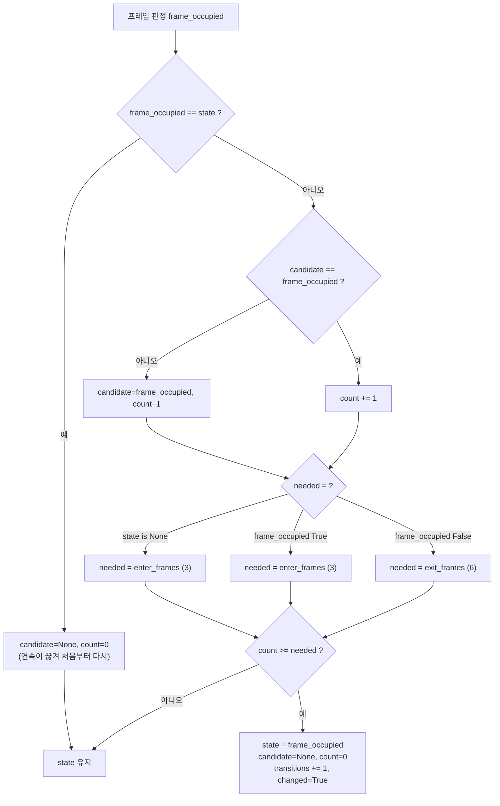
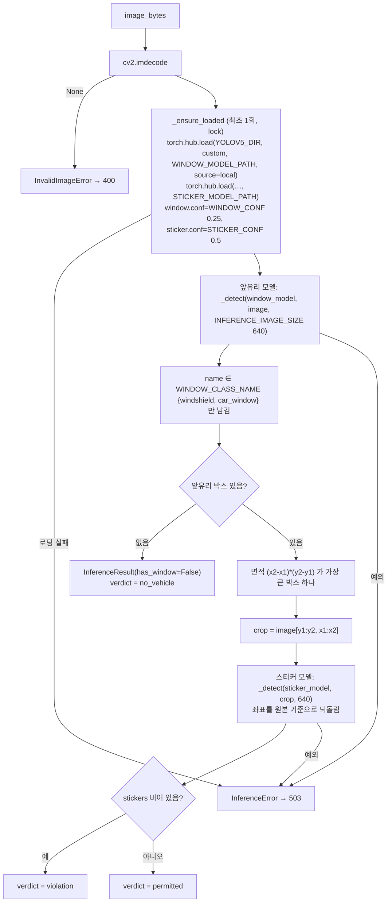
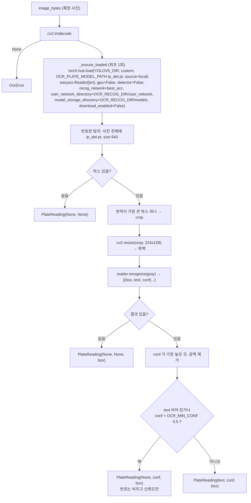

# AI 추론 흐름 (코드 기준, 2026-10-24. 2026-10-25 갱신)

두 단계의 AI가 있다. Pi의 차량 탐지(언제 보낼지), 서버의 앞유리·스티커 판정(위반인지). 각각 어느 파일의 어느 함수가 무엇을 기준으로 판단하는지 적는다.

> **2026-10-25:** 세 번째 단계였던 서버 번호판 OCR 은 **제거**됐다(ADR 0017). 3절은 당시 구현의 기록으로 남긴다. `adapters/ocr.py` 는 없고, 모델은 `C:\parking_guardian\archive\ocr-models\` 에 보관.

## 1. Raspberry Pi 차량 탐지 (`device/vehicle_detector.py`, `device/pi_client.py`)

### 1.1 프레임 입력

| 단계 | 코드 | 내용 |
|---|---|---|
| 카메라 설정 | `pi_client.Hardware.__init__(led_pin, lores=True)` | event 모드는 Picamera2 preview 구성에 `main` 3280x2464 와 `lores` 640x480 `YUV420` 두 스트림. interval 모드는 main 만 |
| 판정용 프레임 | `Hardware.capture_frame()` | `camera.capture_array("lores")` → `cv2.cvtColor(yuv, COLOR_YUV2BGR_I420)` → 640x480 BGR. **실제 Pi에서 미검증** |
| 전송용 사진 | `Hardware.capture()` → `load_jpeg(path, PG_SEND_WIDTH=1280, PG_JPEG_QUALITY=92)` | main 스트림을 `/tmp/parking_guardian_capture.jpg` 로 저장. 가로가 1280 이하면 원본 바이트 그대로, 크면 INTER_AREA 로 줄여 JPEG 92 |
| PC 대역 | `FakeHardware(image_path)` | 사진 1장을 640 폭으로 줄여 프레임으로 쓰고, 전송도 같은 사진 |

### 1.2 YOLO26s 탐지 → 박스

`VehicleDetector.detect_boxes(frame_bgr)` (`vehicle_detector.py` 212행 부근)

- 모델: `YOLO(model_path, task="detect")`. `model_path` 는 `PG_DETECTOR_MODEL`(기본 `yolo26s_ncnn_model`, NCNN 폴더) 또는 `.pt`. 첫 호출 때 로딩.
- 호출: `model(frame, imgsz=480, conf=min(0.1, min_conf), classes=[2, 3, 5, 7], verbose=False)`. COCO 클래스 car, motorcycle, bus, truck 만. 신뢰도 하한은 0.1로 낮게 받고 **판정 단계에서 0.40으로 거른다**.
- 출력: `[(x1, y1, x2, y2, conf, cls), ...]` 픽셀 좌표.

### 1.3 ROI 판정 → 프레임 점유

`RoiJudge.judge(boxes, width, height, currently_occupied)` (`vehicle_detector.py` 122~157행). 박스마다 아래 다섯 가지를 모두 통과해야 "그 칸의 차"로 인정하고, 인정된 박스가 하나라도 있으면 그 프레임은 **점유**다.

| 번호 | 검사 | 계산 | 기준(기본값, 설정) | 제외 사유 문자열 |
|---|---|---|---|---|
| ① | 신뢰도 | `conf` | `≥ 0.40` (`PG_OCC_MIN_CONF`) | `conf 0.16 < 0.4` |
| ② | 크기 | `(w*h) / (W*H)` | `≥ 0.05` (`PG_OCC_MIN_AREA`) | `area 2.2% < 5%` |
| ③ | 아랫변 중심 | `((x1+x2)/2, y2)` 가 ROI 다각형 안 (`cv2.pointPolygonTest ≥ 0`) | 안에 있어야 함 | `bottom-center outside ROI` |
| ④ | 겹침 | `ROI 마스크[y1:y2, x1:x2].sum() / (w*h)` | 비점유 상태면 `≥ 0.30` (`PG_OCC_OVERLAP_ENTER`), 점유 상태면 `≥ 0.15` (`PG_OCC_OVERLAP_EXIT`) | `overlap 28% < 30%` |
| ⑤ | 가장자리 잘림 | `x1 ≤ 1%W 또는 x2 ≥ 99%W` 이고 `w/W < 0.35` (`PG_OCC_EDGE_CLIP_MAX_WIDTH`) | 해당하면 제외 | `clipped at frame edge, width 24%` |

- ROI: `PG_ROI` 정규화 좌표 `x1,y1,x2,y2,...`(점 3개 이상). 기본 `0.10,0.57,0.90,0.57,1.00,1.00,0.00,1.00` (sample_c 구도의 사다리꼴, 위 변이 벽 쪽). `_prepare()` 가 프레임 크기마다 다각형과 마스크를 한 번 만든다.
- ④의 기준이 상태에 따라 다른 것이 이력 현상(hysteresis)이다. 들어올 때는 엄격(0.30), 나갈 때는 느슨(0.15)해서 경계에서 흔들리지 않는다.
- 반환 `FrameJudgement(occupied, boxes[BoxJudgement...], elapsed_ms)`. `BoxJudgement.reasons` 가 비어 있으면 인정.

### 1.4 연속 프레임 → 점유 상태

`OccupancyTracker.update(frame_occupied)` (`vehicle_detector.py` 169~191행). 상태 `state` 는 `None`(부팅 직후) / `True` / `False`.

카운터 규칙을 말로 풀면:

- **증가**: 현재 상태와 다른 판정이 같은 방향으로 이어질 때 1씩.
- **초기화(0)**: 현재 상태와 같은 판정이 한 번이라도 나오면 0. 반대 방향 후보가 나오면 1부터 다시(예: 점유 중에 비점유 2장 뒤 점유 1장이 오면 카운터는 0).
- **전환**: 비점유→점유는 3프레임(5초 간격이면 15초), 점유→비점유는 6프레임(30초). 부팅 직후(`None`)는 어느 쪽이든 3프레임.
- 이 규칙은 "자리에 무언가 계속 있다"만 말한다. 같은 차인지는 모른다.

`VehicleDetector.process_frame(frame)` 이 1.2 → 1.3 → 1.4 를 한 번에 하고 `elapsed_ms` 를 잰다. 1.3 의 `currently_occupied` 에는 `bool(tracker.state)` 를 넣는다.

### 1.5 점유 상태 → 사진 전송 (`pi_client.EventModeRunner`)

`step()` 한 번의 순서(307~338행): ① Heartbeat 기한이면 전송 ② `confirm_due` 기한이면 `confirm` 사진 ③ 점유 중이고 `refresh_due` 기한이면 `refresh` 사진 ④ 프레임 기한이면 1.2~1.4 실행 후 `tracker.state` 가 `None` 이 아니고 `self.occupied` 와 다르면 `_occupancy_changed()` ⑤ 다음 기한까지 sleep.

| 전환 | 조건 | 하는 일 (`_occupancy_changed`, 340~354행) |
|---|---|---|
| 진입 | `state True`, `occupied` 가 `False` 또는 `None` | `occupied=True`, `refresh_due = now + 600`, `arrived` 사진 |
| 출차 | `state False`, `occupied True` | `occupied=False`, `confirm_due=None`(대기 중 확인 사진 취소), `refresh_due=None`, `left` 사진 |
| 부팅 직후 빈 자리 | `state False`, `occupied None` | `occupied=False` 만. **사진 없음** |

`_send(event)` (356~378행): 촬영 실패는 로그 후 중단. 전송 실패(`None`)는 로그만, **재시도 없음**. 성공하면 `result == "violation_pending"` 이고 아직 점유 중일 때만 `confirm_due = now + 60`. LED는 `result in ("violation", "violation_ongoing")`.

Heartbeat는 점유 여부와 무관하게 `PG_HEARTBEAT_INTERVAL`(60초)마다. 본문 없음.

## 2. 서버 AI 추론 (`backend/app/adapters/inference.py`)

### 2.1 진입

`api/device.py create_detection()` 81행: `adapters.inference().analyze(image_bytes, upload.filename)`. 구현은 `build_inference(config)` 가 고른다: `INFERENCE_BACKEND=yolo`(기본) → `YoloInference`, `mock` → `MockInference`.

### 2.2 YoloInference 흐름

- `_detect()` 는 BGR→RGB 변환 뒤 `model(image, size=640)` → `results.pandas().xyxy[0]` → `[{name, coords[x1,y1,x2,y2], confidence}]`.
- 모델 호출은 `self._lock` 안에서 한다(hub 모델은 동시 호출에 안전하지 않음). gunicorn 은 worker 1개, thread 4개라 요청은 받되 추론은 한 번에 하나다.
- Windows 에서는 체크포인트의 `PosixPath` 때문에 `pathlib.PosixPath = pathlib.WindowsPath` 로 우회한다.
- 반환 `InferenceResult(has_window, stickers, window{coords, confidence}, elapsed_ms, backend)`. `verdict` 는 속성: `not has_window → no_vehicle`, `stickers → permitted`, 그 외 `violation`. `to_dict()` 가 응답의 `inference` 가 된다.

### 2.3 판정값의 정확한 조건

| `verdict` | 조건 | 뜻 |
|---|---|---|
| `no_vehicle` | 앞유리 클래스 박스가 **하나도 없음** (신뢰도 0.25 이상 기준) | 차가 없다고 본다. 차가 있어도 앞유리를 못 찾으면 같은 값이다(`UNKNOWN` 은 없다) |
| `permitted` | 가장 큰 앞유리 crop 안에서 스티커 박스가 **1개 이상** (신뢰도 0.5 이상) | 장애인 스티커 차량 |
| `violation` | 앞유리는 있는데 스티커 박스가 0개 | 위반 의심. 사건 묶기의 입력 |

사진에 차가 여러 대면 **가장 큰 앞유리 한 대**만 본다. 옆 칸 차량이 위반으로 잡히지 않게 하려는 규칙이다.

### 2.4 Mock

`MockInference.analyze()`: 파일 이름에 `permitted` → permitted, `novehicle` → no_vehicle, `violation` → violation, 그 외 기본값(`MOCK_INFERENCE_VERDICT`, 기본 `violation`). 테스트와 `INFERENCE_BACKEND=mock` 에서 쓴다. 빈 바이트는 `InvalidImageError`.

### 2.5 실패 처리

| 예외 | 어디서 | HTTP | DB |
|---|---|---|---|
| `InvalidImageError` | 디코드 실패, 빈 파일 | 400 `validation_error` "이미지 파일을 읽을 수 없습니다." | 변경 없음 |
| `InferenceError` | 모델 로딩 실패(torch 없음, 파일 없음), 추론 중 예외, 앞유리 모델에 기대한 클래스가 없음 | **503 `inference_unavailable`** | 변경 없음. `record_verdict` 는 호출되지 않는다 |

## 3. 번호판 OCR — **제거됨 (2026-10-25, ADR 0017). 아래는 2026-10-24 구현의 기록**

### 3.1 실행 시점 (당시)

`api/device.py` 3b 단계(약 121~141행). 조건을 전부 만족할 때 **사진 1장에 한 번**:

1. `record_verdict()` 가 `created=True` 를 돌려줬다. 즉 **이 사진으로 위반이 확정된 순간**(두 번째 위반 판정 사진).
2. 사진 저장 단계가 끝났다(성공·실패 무관).
3. `adapters.ocr().enabled` 가 참. `OCR_ENABLED=true` 일 때만. 기본은 `NoOcr`(enabled False)이라 아무것도 하지 않는다.

`violation_ongoing`, `refresh`, 정상 차량 사진에서는 실행되지 않는다. 정상 차량의 번호판은 읽지 않는다.

### 3.2 과정

### 3.3 결과 저장과 실패 처리 (`api/device.py`)

| 경우 | `violations` 컬럼 | 이력 | 응답 |
|---|---|---|---|
| 읽음 | `plate_number=text`, `plate_confidence=conf` | 없음 | `plate_number` 포함 |
| 번호판 없음·인식 결과 없음 | 둘 다 NULL | `OCR_FAILED` "번호판을 읽지 못했습니다. 사건 기록은 유지됩니다." | 없음 |
| 신뢰도 미달 | `plate_number` NULL, `plate_confidence=conf` | `OCR_FAILED` (같은 문구) | 없음 |
| 예외(`OcrError` 등 모든 예외) | 둘 다 NULL (rollback) | `OCR_FAILED` "번호판 인식에 실패했습니다. 사건 기록은 유지됩니다." | 없음 |

어느 경우에도 위반 행, 사진, 알림에는 영향이 없다. OCR 다음에 알림이 간다. 화면은 `ViolationDetailModal.js` 의 "번호판" 줄에 `번호 (인식 신뢰도 N%)` 또는 `-` 를 보여 준다.

### 3.4 원본 EasyKoreanLpDetector 와 다른 점

| 항목 | 원본 `server.py` (Streamlit) | 이 코드 |
|---|---|---|
| 파이프라인 | 차량 탐지(YOLO26s, COCO 2·3·5·7) → 차량 crop 안에서 번호판 탐지 → 인식. 차가 없으면 전체에서 번호판 탐지 | **차량 탐지 단계 없음.** 사진 전체에서 번호판 탐지 → 가장 큰 박스 하나만 인식 |
| 번호판 모델 로딩 | `torch.hub.load("ultralytics/yolov5", "custom", "lp_det.pt")` (GitHub에서 받음) | 로컬 `YOLOV5_DIR` 로 `source="local"` (앞유리 모델과 같은 방식) |
| EasyOCR Reader | `Reader(["en"], detect_network="craft", recog_network="best_acc", user_network_directory, model_storage_directory)` | `detector=False`, `download_enabled=False`, `gpu=False` 추가. CRAFT 텍스트 탐지기는 로딩·다운로드하지 않는다 |
| crop 전처리 | 224x128 리사이즈 → 흑백 | 같음 |
| 인식 결과 | `recognize(gray)[0][1]` 텍스트만. 신뢰도 무시. 번호판마다 전부 읽어 그림에 그림 | 신뢰도 최대 1개, 공백 제거, **0.5 미만이면 버림**. 그림 없음 |
| 모델 파일 위치 | 저장소 루트 `lp_det.pt`, `lp_models/` | `backend/models/lp_det.pt`, `backend/models/lp_models/` (Git 제외, 컨테이너는 `/models`) |

차량 crop 단계를 뺀 결과로 샘플 3장 중 1장(sample_c)을 높은 신뢰도로 잘못 읽었다(`docs/measurements/README.md` "OCR 비용"). 사용자가 개선은 우선순위가 아니라고 해서 그대로 두었다.
