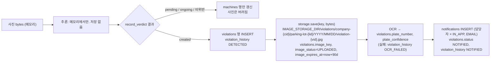

# 설정값·데이터 흐름 (코드 기준, 2026-10-24. 2026-10-25 갱신)

> **2026-10-25 변경**(AWS Phase 1 사전 작업): 번호판 OCR 제거(ADR 0017, `OCR_*` 설정과 `plate_*` 응답 필드 삭제, 컬럼은 유지), S3 사진 저장 Adapter(ADR 0016, `STORAGE_BACKEND`, `S3_*`), DB 접속을 항목별 변수(`DB_*`)로도 지정, 시드 비밀(`SEED_ADMIN_PASSWORD`, `SEED_DEVICE_KEY_SECRET`)과 `flask device-key` 명령, 프록시 헤더 신뢰(ProxyFix). 1.2절 표와 4·5절은 갱신했고, 2절 그림의 OCR 상자는 더 이상 존재하지 않는다.

## 1. 환경변수와 기본값

### 1.1 장비 (`device/pi_client.py`, `device/vehicle_detector.py`)

| 변수 | 기본값 | 쓰임 |
|---|---|---|
| `PG_SERVER_URL` | `http://127.0.0.1:5000/api/v1` | 서버 주소 |
| `PG_DEVICE_KEY` | 없음(필수) | `X-Device-Key` |
| `PG_ZONE_NAME` | 없음 | 사진의 `zone_name`. 장비가 구역 하나에 연결돼 있으면 생략 |
| `PG_MODE` | `event` | `event`(운영 기본) / `interval`(비교·성능 측정용 보조 모드. 2026-10-24 기본값을 interval → event 로 변경) |
| `PG_INTERVAL` | 60 | interval 모드 촬영 주기(초). event 모드는 쓰지 않음 |
| `PG_SEND_WIDTH` | 1280 | 전송 사진 최대 가로. 이하면 재압축 없이 원본 |
| `PG_JPEG_QUALITY` | 92 | 줄일 때 JPEG 품질 |
| `PG_LED_PIN` | 4 | BCM 핀 |
| `PG_DETECT_INTERVAL` | 5 | event: 프레임 간격(초) |
| `PG_HEARTBEAT_INTERVAL` | 60 | event: Heartbeat 간격 |
| `PG_REFRESH_INTERVAL` | 600 | event: 주차 중 확인 사진 간격 |
| `PG_CONFIRM_DELAY` | 60 | event: `violation_pending` 뒤 확인 사진까지 |
| `PG_DETECTOR_MODEL` | `yolo26s_ncnn_model` | event: 차량 탐지 모델(폴더 또는 `.pt`). `roi_preview.py` 의 기본은 `yolo26s.pt` |
| `PG_DETECTOR_IMGSZ` | 480 | 탐지 입력 크기 |
| `PG_ROI` | `0.10,0.57,0.90,0.57,1.00,1.00,0.00,1.00` | 주차면 다각형(정규화) |
| `PG_OCC_MIN_CONF` | 0.40 | 박스 신뢰도 하한 |
| `PG_OCC_MIN_AREA` | 0.05 | 박스 면적/화면 하한 |
| `PG_OCC_OVERLAP_ENTER` / `PG_OCC_OVERLAP_EXIT` | 0.30 / 0.15 | 박스∩ROI/박스 하한(비점유 상태 / 점유 상태) |
| `PG_OCC_EDGE_CLIP_MAX_WIDTH` | 0.35 | 좌우 끝에 잘린 박스의 폭 상한 |
| `PG_OCC_ENTER_FRAMES` / `PG_OCC_EXIT_FRAMES` | 3 / 6 | 연속 프레임 |

명령줄 인자(`--server`, `--key`, `--zone`, `--interval`, `--send-width`, `--jpeg-quality`, `--led-pin`, `--mode`, `--detect-interval`, `--image`, `--once`, `--count`)가 환경변수보다 우선한다.

### 1.2 서버 (`backend/app/config.py`, `.env` 또는 환경변수)

| 변수 | 기본값 | 쓰임 |
|---|---|---|
| `SECRET_KEY`, `JWT_SECRET` | dev 값 | 토큰 서명 |
| `ACCESS_TOKEN_MINUTES` / `REFRESH_TOKEN_DAYS` | 15 / 14 | 관리자 로그인 |
| `COOKIE_SECURE`, `COOKIE_SAMESITE`, `CORS_ORIGINS` | false, Lax, `http://localhost:3000` | 브라우저 |
| `DATABASE_URL` | `sqlite:///backend/instance/parking_guardian.db` | Compose 는 PostgreSQL. 있으면 아래 `DB_*` 보다 우선 |
| `DB_HOST`, `DB_PORT`, `DB_NAME`, `DB_USER`, `DB_PASSWORD`, `DB_SSLMODE` | 없음, 5432, `parking_guardian`, `parking`, 없음, `require` | `DATABASE_URL` 이 없고 `DB_HOST` 가 있으면 `config.build_database_url()` 이 URL 을 조립(비밀번호 URL 인코딩). EKS 에서 비밀번호(Secrets Manager)와 호스트(Terraform 출력)의 출처가 달라서 둔 길 |
| `STORAGE_BACKEND` | `local` | `local`(디스크) / `s3`(ADR 0016). `adapters.storage.build_storage()` |
| `S3_BUCKET`, `S3_PREFIX`, `AWS_REGION` | 없음 | `s3` 일 때. 자격 증명은 boto3 기본 체인(Pod Identity, `aws sso login`) |
| `IMAGE_STORAGE_DIR` | `backend/storage` | `local` 일 때 사진 폴더(컨테이너 `/data/storage`) |
| `IMAGE_URL_TTL_SECONDS` | 300 | 사진 주소 유효 시간 |
| `IMAGE_RETENTION_DAYS` | 90 | 사진을 저장할 때 `violations.image_expires_at` 을 계산하는 데만 쓰인다. **사진 자동 삭제와 `ImageStatus.EXPIRED` 전환은 구현되지 않았다.** 삭제 기능은 S3 저장소 구축 단계에서 검토(사용자 결정 2026-10-24) |
| `MAX_UPLOAD_MB` | 15 | 업로드 상한 |
| `INFERENCE_BACKEND` | `yolo` | `yolo` / `mock` |
| `YOLOV5_DIR` | `../yolov5` | torch.hub 로컬 소스(컨테이너 `/opt/yolov5`) |
| `WINDOW_MODEL_PATH` / `STICKER_MODEL_PATH` | `models/default.pt` / `models/last.pt` | 앞유리 / 스티커 모델(컨테이너 `/models/…`) |
| `WINDOW_CLASS_NAME` | `windshield,car_window` | 앞유리로 인정할 클래스 이름 |
| `WINDOW_CONF` / `STICKER_CONF` | 0.25 / 0.5 | 모델 신뢰도 하한 |
| `INFERENCE_IMAGE_SIZE` | 640 | 두 모델의 입력 크기 |
| ~~`OCR_*` 5개~~ | | 2026-10-25 삭제(ADR 0017) |
| `SEED_ADMIN_PASSWORD` | 없음 → `Passw0rd!` | `flask seed` 가 **새로 만드는** 계정의 초기 비밀번호. 기존 계정은 바꾸지 않음 |
| `SEED_DEVICE_KEY_SECRET` | 없음 → `pgk_dev_<serial>` | 있으면 데모 장비 키 = `pgk_` + HMAC-SHA256(secret, SERIAL) 앞 32자. `flask device-key SERIAL` 로 확인. 기존 장비 키는 바꾸지 않음 |
| `DEVICE_NAIVE_TZ` | `Asia/Seoul` | 오프셋 없는 `detected_at` 의 시간대 |
| `MACHINE_ONLINE_SECONDS` | 300 | 화면의 장비 `online` 판정 |
| `STALE_VIOLATION_HOURS` | 24 | 운영 지표 "방치된 위반" |
| `VIOLATION_CONFIRM_COUNT` | 2 | 위반 확정에 필요한 연속 위반 판정 수 |
| `VEHICLE_CLEAR_COUNT` | 3 | 종료에 필요한 연속 비위반 수(`event=left`+`no_vehicle` 은 1) |
| `EPISODE_GAP_MINUTES` | 10 | 신호 끊김 종료 |
| `NOTIFICATION_CHANNELS`, `EMAIL_BACKEND` | `("IN_APP","EMAIL")`, `console` | **현재 어디서도 읽지 않는 설정.** 채널은 `models.Channel.ALL`, 이메일은 항상 `ConsoleEmailSender`(로그). 실제 이메일 발송은 구현하지 않는다(사용자 결정 2026-10-24). SES/SQS 단계의 자리 |

Compose(`docker-compose.yml`)가 넣는 값: `DATABASE_URL`(db 컨테이너), `SECRET_KEY`, `JWT_SECRET`, `INFERENCE_BACKEND`, `SEED_DEMO_DATA=1`. Dockerfile ENV: `YOLOV5_DIR=/opt/yolov5`, 모델 경로 2개(`default.pt`, `last.pt`), `IMAGE_STORAGE_DIR=/data/storage`. 모델 폴더는 `./backend/models:/models:ro` 로 연결. Compose 는 `STORAGE_BACKEND`, `DB_*`, `SEED_*` 를 주지 않으므로 로컬 기본값(디스크 저장, 고정 데모 비밀번호·키)으로 돈다.

`create_app()` 은 `ProxyFix(x_for=1, x_proto=1, x_host=1)` 로 앞단 프록시 1홉(Compose 의 nginx, AWS 의 ALB)의 `X-Forwarded-*` 를 믿는다. 사진 주소(`url_for(_external=True)`)가 브라우저가 쓴 scheme·host 로 나온다.

## 2. 데이터 흐름

### 2.1 사진 한 장이 남기는 것

- 사진은 **위반을 확정한 그 한 장만** 저장된다. `arrived`(첫 위반 판정), `refresh`, `left`, 정상 차량 사진은 저장되지 않는다. 재압축하지 않고 받은 바이트 그대로 쓴다(`storage.save(key, image_bytes)`).
- 키의 날짜는 위반의 `detected_at`(첫 사진 시각, UTC). 확장자는 `sniff_image_type()` 이 매직 바이트로 정한다(jpg/png/webp).
- `LocalImageStorage._path()` 는 키가 `base_dir` 밖으로 나가면 `ValueError`.

### 2.2 테이블별 쓰기 지점

| 테이블 | 누가 쓰는가 |
|---|---|
| `machines` | `record_verdict()`(카운터, 마지막 신호), `heartbeat()`(`last_heartbeat_at`), 운영자 API(등록, 키 재발급, 상태) |
| `violations` | `create_violation()`, `record_verdict()`(`last_seen_at`, `detection_count`, `ended_at`, `end_reason`), `device.py`(`image_*`, `plate_*`), `violations.py _transition()`(`status`, `resolved_*`) |
| `violation_history` | `add_history()` 를 부르는 모든 곳(위 표의 `action` 값) |
| `notifications` | `notify_violation()`(생성·전달), `api/notifications.py`(`READ`) |
| `audit_logs` | 운영자의 구조 변경 API(회사, 관리자, 주차장, 구역, 장비) |
| `refresh_tokens` | 로그인·갱신·로그아웃 |

### 2.3 시각의 기준

| 값 | 기준 |
|---|---|
| `violations.detected_at` | 장비가 보낸 `detected_at`(첫 위반 판정 사진). 없으면 서버 시각 |
| `last_seen_at`, `ended_at`, `last_detection_at`, `last_heartbeat_at`, `created_at` 류 | 서버 `utcnow()` |
| 응답·API 의 시각 | `iso()` 로 `YYYY-MM-DDTHH:MM:SSZ` (UTC) |
| SQLite | naive 로 저장되므로 `as_utc()` 가 UTC 를 붙여 읽는다 |

## 3. 데모 데이터 (`backend/app/cli.py seed`)

`flask seed`(Compose 는 `SEED_DEMO_DATA=1` 로 시작 때 실행). 있으면 건너뛴다. SUPER_ADMIN `super@pg.local`, 회사 A·B, 관리자 `kim@a.com`(강남·판교 담당), `lee@a.com`(판교), `park@a.com`(수원), `choi@b.com`, 주차장마다 장비 1대와 구역. 장비 키는 `pgk_dev_<시리얼 소문자>` (예 `pgk_dev_rpi-a-gangnam-01`). 비밀번호는 모두 `Passw0rd!`.

## 4. 오류 처리: 구현된 것

| 지점 | 실패 | 처리 |
|---|---|---|
| Pi 촬영 | 예외 | `_send()` 로그 후 그 이벤트 포기 |
| Pi 전송 | 네트워크 예외, 401/403/503/기타 | `send_photo()` 가 코드별 로그 후 `None`. **재시도 없음**. LED 는 이전 상태 유지 |
| Pi `step()` 예외 | 모든 예외 | `run_event_mode()` 가 로그 후 `detect_interval` 쉬고 계속 |
| Pi Heartbeat | 실패 | 로그만 |
| 서버 인증 | 키 오류·비활성 | 401 / 403 |
| 입력 | 파일·시각·event 오류 | 400 |
| 추론 | 디코드 / 모델·추론 실패 | 400 / **503**, DB 변경 없음 |
| 사건 묶기 동시성 | 같은 장비 동시 사진 | 행 잠금으로 직렬화. UNIQUE Index 위반은 `violation_ongoing` 으로 흡수 |
| 사진 저장 | 예외 | `image_status=FAILED`, 이력 `IMAGE_UPLOAD_FAILED`, 위반 유지 |
| OCR | 예외·미인식·신뢰도 미달 | 컬럼 비움, 이력 `OCR_FAILED`, 위반·알림 유지 |
| 알림 | 담당자 없음 / 채널 전달 예외 / publish 예외 | 이력 `NOTIFY_FAILED`(담당자 없음) / 알림 행 `FAILED` / 이력 `NOTIFY_FAILED`. 위반 유지, 요청은 201 |
| 관리자 상태 전이 | 동시 클릭, 허용되지 않은 상태 | 409 `invalid_transition`, 화면이 목록 새로 고침 |
| 처리되지 않은 예외 | | `errors.py` 가 rollback 후 500 `internal_error` |

## 5. 미구현·주의 (코드에 없는 것)

- Pi: 전송 실패 재시도, 오프라인 큐, `seq`/`event_id`, Heartbeat 에 점유 상태·탐지 프로세스 상태, 탐지 프로세스만 죽은 경우의 감지, 재부팅 뒤 상태 복원(부팅 직후 빈 자리는 사진 없음, 점유면 `arrived`).
- 서버: `UNKNOWN` 판정, `signal_lost_at`, 복구 동기화, 장기 미복구 정리, 능동 장애 알림(끊김은 다음 사진 때만 판정), `review_required`, `plate_status`, OCR 재실행, 사진 만료·삭제(`IMAGE_RETENTION_DAYS` 는 날짜만 기록, `EXPIRED` 를 쓰는 코드 없음), 실제 이메일 발송(SES), 알림 큐(SQS), S3 저장, 추론 서비스 분리.
- 화면: 사진 만료 문구("보관 기간 만료")는 있으나 만료가 일어나지 않음. (`OCR_FAILED` 라벨은 2026-10-24 추가함.)
- 설정: `NOTIFICATION_CHANNELS`, `EMAIL_BACKEND` 는 읽히지 않는 값.

## 6. 설계 문서와 실제 구현의 차이

실제 코드를 기준으로 적었다. 설계는 `AI_FINAL_DESIGN.md`(1~9절 설계 방향, 10절 MVP 결정), ADR 0014·0015.

| 설계 문서 | 실제 코드 | 비고 |
|---|---|---|
| 4.3 "Heartbeat 에 장비 ID, 점유 상태, 마지막 추론 시각, 탐지 프로세스 상태" | Heartbeat 본문 없음. 서버는 받은 시각만 기록 | MVP 제외(12절) |
| 4.3 "주차 중 10~15분 등의 간격으로 확인 사진" | `PG_REFRESH_INTERVAL` 600초 고정 기본값 | |
| 4.3 "비어 있는 동안 저빈도 사진은 별도 정책" | 없음 | MVP 제외 |
| 5절 5번 "첫 결과가 위반 의심이면 60초 뒤 새 사진을 **요청**한다" | 서버 응답에 요청 필드가 없다. Pi 가 `result: violation_pending` 을 보고 60초 뒤 찍는다 | 10절 10.3 대로 |
| 3절 "판정 불가 UNKNOWN" | 없음. 앞유리를 못 찾으면 `no_vehicle` | 사용자 결정 |
| 6절 장애 처리 표(멱등 ID, 순서, UNKNOWN, 복구 동기화 …) | 끊김 판정, 추론 실패 503, OCR 실패 분리 세 가지만 | MVP 제외 |
| 6.1 "끊김은 종료가 아니라 `signal_lost_at` 기록" | 끊김이면 `SIGNAL_LOST` 로 **종료**(기존 규칙 4 유지). 기준 시각에 Heartbeat 포함 | |
| ADR 0014 서버 표 "`left` 사진을 `no_vehicle` 로 확인하면 사건을 바로 종료" | 같음. 단 `left`+`permitted` 는 3회 규칙(사용자 조건) | |
| ADR 0014 Pi 표 "`PG_DETECTOR_MODEL` 설정" | 있음. 기본 `yolo26s_ncnn_model`. PC 도구 `roi_preview.py` 의 기본은 `yolo26s.pt` | |
| ADR 0015 결정 1 "파이프라인은 차량 탐지(YOLO26s) → 번호판 탐지 → 인식" | **차량 탐지 단계 없음.** 사진 전체에서 가장 큰 번호판 | 결정 문서의 "범위" 줄과 `FLOW_AI_INFERENCE.md` 3.4 에 기록 |
| ADR 0015 결정 3 "`plate_status`, 못 읽으면 `plate_status=UNKNOWN`" | 컬럼 없음. 못 읽으면 `plate_number` NULL + 이력 `OCR_FAILED` | MVP 제외 |
| ADR 0015 결정 5 "refresh 사진 OCR 재실행, 확인 필요" | 없음 | MVP 제외 |
| 2절 다이어그램 "E left → 서버에서 차량 부재 검증 → 확인되면 기존 사건 종료" | 같음(`no_vehicle` 일 때만) | |
| `docs/design/EXECUTION_FLOW.md`(2026-10-20) "장비는 1분마다 사진" | 두 모드. event 모드가 추가됨 | 이 문서 네 개가 대체 |
| `device/pi_client.py` 머리말 "PG_DETECTOR_MODEL 기본 yolo26s_ncnn_model (폴더) 또는 yolo26s.pt" | 코드 기본값은 폴더 하나 | 문구 |
