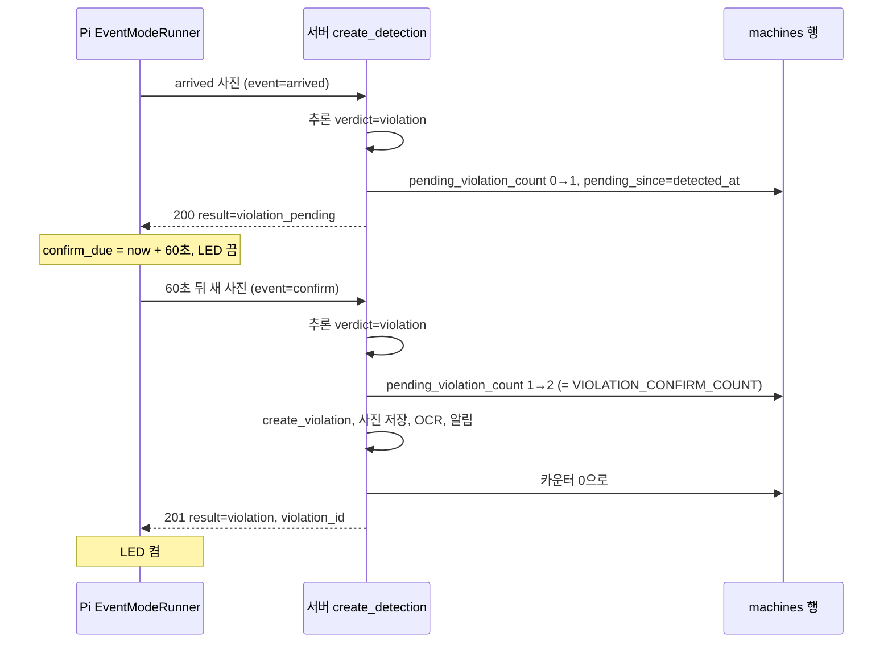
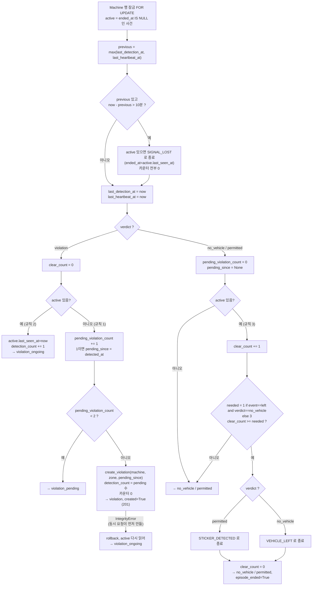
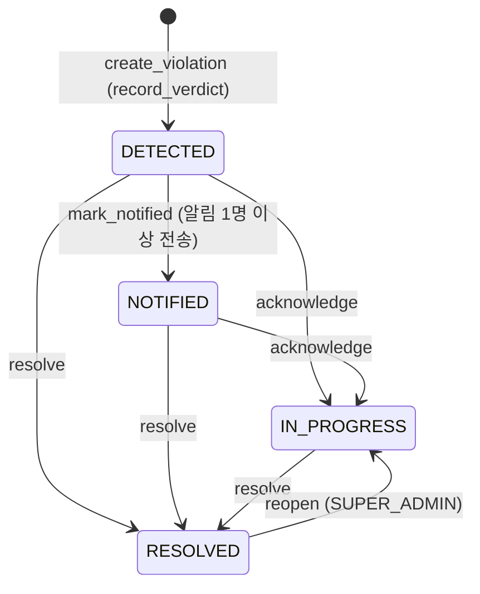
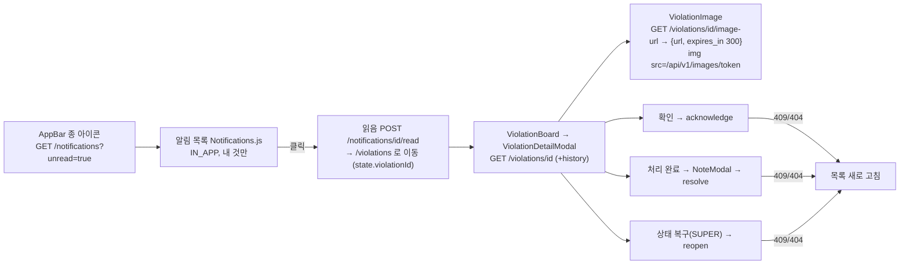

# 이벤트·사건 상태 흐름 (코드 기준, 2026-10-24. 2026-10-25 갱신 주석)

장비가 언제 무엇을 보내는지, 서버가 그것으로 사건을 어떻게 만들고 닫는지, 관리자가 어떻게 처리하는지. 값(판정값, 결과값, 상태값, 종료 사유)의 전체 목록은 6절.

> **2026-10-25 변경:** 번호판 OCR 제거(ADR 0017). 1.1절 응답의 `plate_number?` 는 더 이상 없다. 2절 그림과 4절 본문의 "OCR" 단계도 없다(사진 저장 → 알림). 이력 `action` 목록의 `OCR_FAILED` 와 화면 라벨은 과거 이력 호환을 위해 코드에 남아 있지만 새로 생기지 않는다. 사건 묶기 규칙은 변경 없음.

## 1. 장비 ↔ 서버 통신

### 1.1 엔드포인트

| 요청 | 인증 | 요청 본문 | 응답 | 코드 |
|---|---|---|---|---|
| `POST /api/v1/device/detections` | 헤더 `X-Device-Key` | multipart: `file`(필수), `detected_at`(선택, ISO 8601 또는 `YYYY-MM-DD HH:MM:SS`, 오프셋 없으면 `DEVICE_NAIVE_TZ`), `zone_name`(선택), `event`(선택: `arrived` `confirm` `refresh` `left`) | JSON `{result, inference{backend, verdict, window, sticker_count, stickers, elapsed_ms}, violation_id?, episode_ended?, plate_number?}`. 새 위반이면 **201**, 그 외 **200** | `api/device.py create_detection()` |
| `POST /api/v1/device/heartbeat` | 같음 | 없음 | `{ok: true, server_time}` 200 | `api/device.py heartbeat()` → `touch_heartbeat()` |

오류 응답은 모두 `{"error": {"code", "message"}}` (`errors.py`).

| 상황 | HTTP | code |
|---|---|---|
| 키 없음·틀림 | 401 | `unauthorized` |
| 장비·주차장·회사가 `INACTIVE` | 403 | `forbidden` |
| `file` 없음, 빈 파일, `detected_at` 형식 오류, `event` 값이 네 가지 밖 | 400 | `validation_error` |
| 이미지 디코드 실패 | 400 | `validation_error` |
| 모델 로딩·추론 실패 | 503 | `inference_unavailable` |
| 15 MB(`MAX_UPLOAD_MB`) 초과 | 413 | `payload_too_large` |

장비 인증(`auth/decorators.py require_device()`): 키를 SHA-256 해시해 `machines.api_key_hash` 로 찾는다. 회사·주차장은 DB의 장비 행에서 나오고 요청에는 없다.

### 1.2 장비가 보내는 때 (`device/pi_client.py`)

| 모드 | 언제 | `event` | Heartbeat |
|---|---|---|---|
| event (기본, `PG_MODE=event`. 운영 모드) | 아래 네 경우 | 있음 | 60초마다 `send_heartbeat()` |
| interval (`PG_MODE=interval`. 비교·성능 측정용 보조 모드) | `PG_INTERVAL`(60초)마다. 차가 없어도 | 없음 | 보내지 않음. 사진이 `last_heartbeat_at` 도 갱신 |

| `event` | 발생 조건 (`EventModeRunner`) | 서버가 다르게 처리하는가 |
|---|---|---|
| `arrived` | `OccupancyTracker.state` 가 `True` 로 바뀜(연속 3프레임 점유). 부팅 직후 바로 점유면 이것도 `arrived` | 아니오. 일반 사진 |
| `confirm` | 직전 사진 응답이 `result: violation_pending` 이었고 아직 점유 중 → `PG_CONFIRM_DELAY`(60초) 뒤 **새로 찍은** 사진. 그 사이 출차가 확정되면 취소 | 아니오. 일반 사진. 2회 연속 규칙이 그대로 동작 |
| `refresh` | 점유 중 `PG_REFRESH_INTERVAL`(600초)마다. 기준 시각은 `arrived` 전송 시각 | 아니오 |
| `left` | `state` 가 `False` 로 바뀜(연속 6프레임 비점유). 부팅 직후 빈 자리는 보내지 않음 | **예.** 판정이 `no_vehicle` 이면 1회로 종료(3절) |

### 1.3 `violation_pending` 뒤 두 번째 사진

서버 응답 형식은 바뀌지 않았다. "60초 뒤 한 장 더"는 Pi 가 `result` 값을 보고 스스로 정한다(`_send()` 375~377행). 두 번째 사진이 `permitted` 나 `no_vehicle` 이면 카운터가 0이 되고 위반은 생기지 않는다.

## 2. `record_verdict()` 전체 분기 (`backend/app/services/detections.py` 89행~)

입력: `machine_id`, `verdict`(`no_vehicle` / `permitted` / `violation`), `detected_at`, `zone_name`, `event`. 설정: `VIOLATION_CONFIRM_COUNT`=2, `VEHICLE_CLEAR_COUNT`=3, `EPISODE_GAP_MINUTES`=10. 상태는 전부 DB 행(`machines`, `violations`)에 있다.

처리 순서와 커밋: 끊김 판정과 카운터 갱신은 같은 트랜잭션이고 각 반환 직전에 `db.session.commit()` 한다. 사진 저장·OCR·알림은 이 함수 밖(`api/device.py`)에서 `created=True` 일 때만 한다.

### 2.1 위반 2회 확정 규칙 (규칙 1)

- 진행 중 사건이 없을 때 `violation` 판정이 오면 `pending_violation_count` 가 1 늘고, 1이 되는 순간 `pending_since` 에 그 사진의 `detected_at` 을 둔다.
- 2(`VIOLATION_CONFIRM_COUNT`)가 되면 `create_violation()`. 위반의 `detected_at` 은 **첫 사진 시각**(`pending_since`), `detection_count` 는 2, `last_seen_at` 은 서버 시각.
- 사이에 `no_vehicle` 이나 `permitted` 가 한 장이라도 오면 카운터는 0. 끊김(10분)에도 0.
- 같은 사진을 두 번 보내도 두 번으로 센다(서버는 사진이 같은지 모른다). Pi 의 event 모드는 새 사진을 찍는다.

### 2.2 기존 사건 갱신과 중복 방지 (규칙 2)

- 진행 중 사건이 있으면 `violation` 판정은 새 사건을 만들지 않고 `last_seen_at`, `detection_count` 만 갱신 → `violation_ongoing`. 관리자가 `RESOLVED` 로 바꿨어도 `ended_at` 이 비어 있으면 같다.
- 중복 방지 두 겹: ① `select(Machine).with_for_update(of=Machine)` 로 같은 장비의 사진을 한 장씩 처리 ② `violations` 의 조건부 UNIQUE Index `uq_violations_active_per_machine (machine_id) WHERE ended_at IS NULL` (`models/violation.py`). ②에 걸리면 `IntegrityError` 를 잡아 `violation_ongoing` 으로 처리한다.
- 알림은 `created=True` 인 요청에서만 한 번. `notifications` 의 UNIQUE `(violation_id, admin_id, channel)` 이 재호출 중복을 막는다.

### 2.3 비위반 3회 종료 규칙과 `event=left` 예외 (규칙 3)

- 진행 중 사건이 있을 때 `no_vehicle`/`permitted` 가 오면 `clear_count` 가 1 늘고, `violation` 이 오면 0이 된다.
- `clear_count ≥ 3` 이면 종료. 마지막 판정이 `permitted` 면 `STICKER_DETECTED`(이력 메시지에 "처음 판정이 잘못되었을 수 있습니다"), `no_vehicle` 이면 `VEHICLE_LEFT`.
- **예외**: `event=left` **이고** 판정이 `no_vehicle` 이면 필요 횟수가 1이다(174행 `needed`). `event=left` 인데 `permitted` 면 3회 규칙 그대로, `violation` 이면 규칙 2(`violation_ongoing`)다.
- 종료 시각 `ended_at` 은 서버 시각 `now`. 종료해도 `status` 는 그대로다(관리자 처리와 독립).

### 2.4 끊김 종료 (규칙 4)

- 기준 시각은 `machines.last_detection_at` 과 `last_heartbeat_at` 중 늦은 것. 사진은 둘 다 갱신하고 Heartbeat 는 후자만 갱신한다.
- 10분 넘게 비어 있으면 진행 중 사건을 `SIGNAL_LOST` 로 닫고(`ended_at` 은 사건의 `last_seen_at`) `pending_violation_count`, `pending_since`, `clear_count` 를 0으로 한 뒤, 들어온 사진을 처음부터 센다.
- 이력 메시지는 "장비에서 N분 동안 사진도 Heartbeat도 들어오지 않아 사건을 종료했습니다."

### 2.5 반환값과 알림 발생 조건

| `result` | `DetectionOutcome` | HTTP | 사진 저장·OCR·알림 | 장비 LED |
|---|---|---|---|---|
| `violation_pending` | `violation=None` | 200 | 없음 | 끔 |
| `violation` | `violation`, `created=True` | 201 | **있음** (이 요청 안에서) | 켬 |
| `violation_ongoing` | `violation` | 200 | 없음 | 켬 |
| `no_vehicle` | `violation`(있으면), `episode_ended` | 200 | 없음 | 끔 |
| `permitted` | 같음 | 200 | 없음 | 끔 |

알림은 **위반 1건당 정확히 한 번**, `created=True` 인 요청에서 `publish_violation_detected()` 로. 담당 관리자가 없으면 알림 없이 이력 `NOTIFY_FAILED` 만 남고 상태는 `DETECTED` 로 머문다.

## 3. 위반 상태와 관리자 처리 (`backend/app/services/violations.py`)

| 동작 | 허용 이전 상태 | 새 상태 | 누가 | 바뀌는 컬럼 | 이력 | 화면 |
|---|---|---|---|---|---|---|
| `mark_notified` | DETECTED | NOTIFIED | 서버 | `status` | `NOTIFIED` "담당 관리자 N명에게 알림을 전송했습니다." | |
| `acknowledge` | DETECTED, NOTIFIED | IN_PROGRESS | 로그인한 관리자(두 Role 모두). COMPANY_ADMIN 은 자기 회사 것만(`ensure_company_access`) | `status` | `ACKNOWLEDGED` "{이름}님이 확인하고 현장 대응을 시작했습니다." | "확인 (현장 대응 시작)" 버튼 |
| `resolve` | DETECTED, NOTIFIED, IN_PROGRESS | RESOLVED | 같음 | `status`, `resolved_at`, `resolved_by`, `resolution_note` | `RESOLVED` "{이름}님이 처리 완료했습니다. 처리 내용: …" | "처리 완료" 버튼 → 메모 입력(`NoteModal`) |
| `reopen` | RESOLVED | IN_PROGRESS | SUPER_ADMIN 만 | `status`, resolved_* 비움 | `REOPENED` "… 사유: …" | "상태 복구" 버튼 |

모든 전이는 `_transition()`: `UPDATE violations SET … WHERE id=? AND status=<읽었던 상태>`. 바뀐 행이 1이 아니면 rollback 후 **409 `invalid_transition`** ("다른 관리자가 먼저 상태를 변경했습니다"). 허용되지 않은 이전 상태도 409. 이력 행은 같은 트랜잭션에서 커밋.

**처리 완료와 차량 존재는 독립이다.** `status` 는 관리자의 일, `ended_at`/`end_reason` 은 장비 사진의 일. 처리 완료 뒤에도 차가 있으면 `violation_ongoing` 이 계속 오고 `last_seen_at` 이 갱신된다. 목록의 "처리 이력" 탭은 `status=RESOLVED`, "미처리" 탭은 `DETECTED/NOTIFIED/IN_PROGRESS` 다(`api/violations.py list_violations`, `status=open|resolved`).

### 3.1 알림 (`backend/app/services/notifications.py`)

- 대상: `recipients_for()` = 그 주차장에 배정된(`admin_parking_lots`) 같은 회사의 `COMPANY_ADMIN` 중 `ACTIVE`. SUPER_ADMIN 은 받지 않는다. 조회 권한은 회사 전체지만 알림은 담당자만.
- 채널: `IN_APP`, `EMAIL` 둘 다 행을 만든다. `_deliver()`: EMAIL 은 `ConsoleEmailSender` 가 로그 한 줄(실제 발송 없음), IN_APP 은 행 자체가 알림. 성공 `SENT`, 예외 `FAILED`(`last_error`). `PENDING`/`FAILED` 인 행만 다시 전달하므로 재호출에 안전.
- 끝나면 위반이 `DETECTED` 일 때만 `mark_notified()`.

### 3.2 관리자 화면 흐름

사진 주소: `create_image_token(violation_id)` 로 만든 JWT(`IMAGE_URL_TTL_SECONDS` 300초). `GET /images/<token>` 은 로그인 헤더 없이 토큰만으로 저장소를 읽어 돌려준다(`Cache-Control: private, max-age=60`). `image_status` 가 `UPLOADED` 가 아니면 404.

## 4. 장비 쪽 상태값

| 값 | 어디 | 뜻 |
|---|---|---|
| `OccupancyTracker.state` | `vehicle_detector.py` | `None` 부팅 직후 / `True` 점유 / `False` 비점유 |
| `EventModeRunner.occupied` | `pi_client.py` | 서버에 마지막으로 알린 점유 상태. `None` 이면 아직 아무 사진도 안 보냄 |
| `confirm_due`, `refresh_due`, `next_heartbeat`, `next_frame` | 같음 | 다음 동작 기한(monotonic 초). `None` 은 예정 없음 |
| `last_result` | 같음 | 마지막 서버 `result` |
| LED | `VIOLATION_RESULTS = ("violation", "violation_ongoing")` | 위반 기록 중이면 켬 |

## 5. 서버 쪽 장비 상태 (`machines`)

| 컬럼 | 갱신 | 쓰임 |
|---|---|---|
| `last_heartbeat_at` | Heartbeat, 사진 | 화면의 `online` (`machine_online()`, 300초), 끊김 판정 |
| `last_detection_at` | 사진(추론 성공 뒤) | 끊김 판정 |
| `pending_violation_count`, `pending_since` | 규칙 1 | 2회 확정 |
| `clear_count` | 규칙 3 | 3회 종료 |

## 6. 값의 전체 목록 (코드에 있는 것만)

| 종류 | 값 | 정의 위치 |
|---|---|---|
| 서버 판정 `verdict` | `no_vehicle`, `permitted`, `violation` | `adapters/inference.py` |
| 장비 응답 `result` | `no_vehicle`, `permitted`, `violation_pending`, `violation`, `violation_ongoing` | `services/detections.py` |
| 장비 `event` | `arrived`, `confirm`, `refresh`, `left` | `services/detections.py EVENTS`, `pi_client.py` |
| 위반 `status` | `DETECTED`, `NOTIFIED`, `IN_PROGRESS`, `RESOLVED` (`OPEN` = 앞 셋) | `models/base.py ViolationStatus` |
| 종료 사유 `end_reason` | `VEHICLE_LEFT`, `STICKER_DETECTED`, `SIGNAL_LOST` | `EndReason` |
| 이력 `action` | `DETECTED`, `NOTIFIED`, `ACKNOWLEDGED`, `RESOLVED`, `REOPENED`, `IMAGE_UPLOAD_FAILED`, `NOTIFY_FAILED`, `OCR_FAILED`, `VEHICLE_LEFT`, `SIGNAL_LOST` | `HistoryAction` |
| 사진 `image_status` | `PENDING`, `UPLOADED`, `FAILED`, `EXPIRED` (EXPIRED 를 쓰는 코드는 없음) | `ImageStatus` |
| 알림 `status` | `PENDING`, `SENT`, `FAILED`, `READ` | `NotificationStatus` |
| 알림 `channel` | `IN_APP`, `EMAIL` | `Channel` |
| 활성 `status` | `ACTIVE`, `INACTIVE` (회사, 관리자, 주차장, 장비) | `Status` |
| Role | `SUPER_ADMIN`, `COMPANY_ADMIN` | `Role` |
| 화면 이력 라벨 | `HISTORY_ACTION_LABEL` (OCR_FAILED → "번호판 인식 실패" 포함) | `frontend/src/utils/format.js` |
