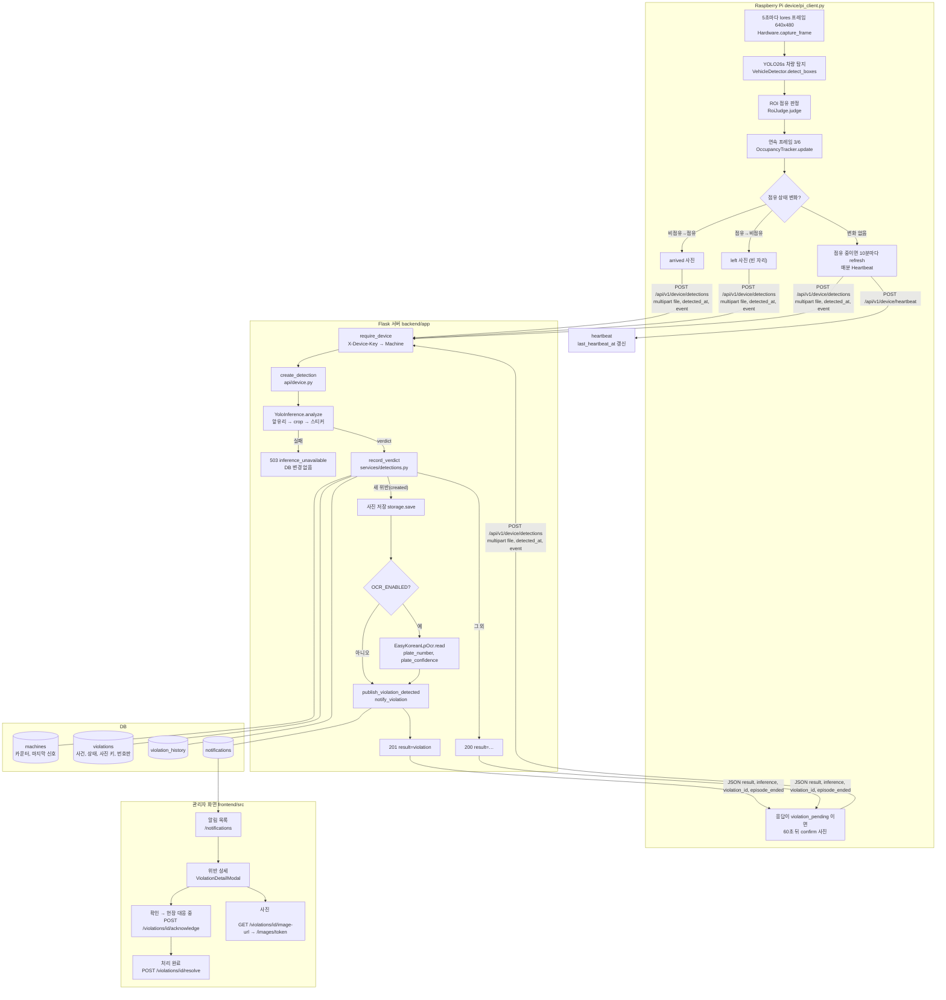

# 전체 시스템 흐름 (코드 기준, 2026-10-24. 2026-10-25 갱신 주석)

2026-10-24 시점의 코드를 직접 읽고 정리했다. 적힌 파일, 함수, 설정값은 모두 저장소에 실제로 있는 것이다. 설계 문서(`AI_FINAL_DESIGN.md`, ADR 0014·0015)와 다른 점은 `FLOW_CONFIG_AND_DATA.md` 6절에 모았다.

> **2026-10-25 변경:** 번호판 OCR 은 제거됐다(ADR 0017). 이 문서에서 OCR, `adapters/ocr.py`, `OCR_ENABLED`, `plate_number`, `OCR_FAILED` 가 나오는 자리(구성 요소 표, 2절 그림의 S6·S7, 3절 6번 단계, 4절의 "OCR 커밋", 시나리오의 "(OCR)"·"번호판")는 더 이상 코드에 없다. `create_detection()` 의 순서는 추론 → 사건 묶기 커밋 → 사진 저장 커밋 → 알림 커밋이다. 사진 저장은 `STORAGE_BACKEND` 로 디스크 또는 S3(ADR 0016)를 고른다.

문서 네 개의 역할:

| 문서 | 내용 |
|---|---|
| **이 문서** `FLOW_SYSTEM.md` | 구성 요소, 호출 관계, 사진 한 장이 끝까지 가는 길, 시나리오 예시 |
| `FLOW_AI_INFERENCE.md` | Pi 차량 탐지(YOLO26s + ROI + 연속 프레임), 서버 앞유리·스티커 추론, OCR |
| `FLOW_EVENTS_AND_EPISODES.md` | 장비 이벤트와 Heartbeat, `record_verdict()` 분기, 위반 상태 전이, 알림, 관리자 처리. 판정값·상태값 표 |
| `FLOW_CONFIG_AND_DATA.md` | 환경변수와 기본값, 데이터·사진 저장 흐름, 오류 처리 구현·미구현, 설계와 구현의 차이 |

## 1. 구성 요소

| 구성 요소 | 역할 | 코드 | 실행 |
|---|---|---|---|
| Raspberry Pi (장비) | 사진을 찍어 서버로 보낸다. **event 모드**에서는 주차면 점유를 판정해 상황이 바뀔 때만 보내고 매분 Heartbeat를 보낸다. **interval 모드**에서는 1분마다 보낸다. 위반인지는 판단하지 않는다 | `device/pi_client.py`, `device/vehicle_detector.py` | Pi에서 `python3 pi_client.py` (`PG_MODE=event`) |
| Flask 서버 | 장비 인증, AI 추론(앞유리 → 스티커), 사건 묶기, 사진 저장, OCR, 알림, 관리자 API | `backend/app/` | `python wsgi.py` 또는 컨테이너의 gunicorn, `/api/v1` |
| AI 추론(서버) | YOLOv5 모델 2개를 Flask 프로세스 안에서 실행 | `backend/app/adapters/inference.py` | 첫 사진 때 지연 로딩 |
| OCR(서버) | 확정된 위반 사진 1장에서 번호판을 읽는다. 기본은 꺼짐 | `backend/app/adapters/ocr.py` | `OCR_ENABLED=true` 일 때만 |
| DB | 회사, 관리자, 주차장, 구역, 장비, 위반, 이력, 알림, 감사 로그, Refresh Token | `backend/app/models/` | SQLite(기본) 또는 PostgreSQL(Compose) |
| 사진 저장소 | 위반이 확정된 순간의 사진 원본 | `backend/app/adapters/storage.py` | 로컬 디스크 `IMAGE_STORAGE_DIR` |
| 관리자 화면 | React. 알림 확인, 위반 목록·상세·사진, 확인·처리 완료 | `frontend/src/` | `npm start` 또는 nginx 컨테이너 |

## 2. 전체 순서도



## 3. 호출 관계 (함수 단위)

### 3.1 장비 → 서버 (event 모드)

```text
device/pi_client.py
  main()
    └─ run_event_mode(hardware, args, limit)
         ├─ VehicleDetector(PG_DETECTOR_MODEL, PG_DETECTOR_IMGSZ, OccupancyConfig.from_env())   device/vehicle_detector.py
         ├─ DeviceCamera(hardware, send_width, jpeg_quality)
         └─ EventModeRunner(camera, detector, EventSettings.from_env(), send_photo, send_heartbeat)
              └─ step()  반복
                   ├─ send_heartbeat()                       → POST /device/heartbeat
                   ├─ _send("confirm")   (confirm_due 도래)
                   ├─ _send("refresh")   (점유 중, refresh_due 도래)
                   ├─ detector.process_frame(camera.capture_frame())
                   │    ├─ detect_boxes()  YOLO
                   │    ├─ RoiJudge.judge()
                   │    └─ OccupancyTracker.update()
                   └─ _occupancy_changed(state)  → _send("arrived") 또는 _send("left")
              _send(event)
                   ├─ camera.capture() → Hardware.capture() → load_jpeg()
                   ├─ send_photo(server, key, jpeg, zone, event)   → POST /device/detections
                   ├─ result == "violation_pending" and occupied → confirm_due = now + 60
                   └─ camera.set_led(result in VIOLATION_RESULTS)
```

interval 모드는 `main()` → `run_cycle()` 반복: `Hardware.capture()` → `load_jpeg()` → `send_photo(event=None)` → `set_led()`. Heartbeat 엔드포인트는 부르지 않는다(사진이 `last_heartbeat_at` 도 갱신한다).

### 3.2 서버 안

```text
backend/app/api/device.py  create_detection()          [@require_device  auth/decorators.py]
  1. 입력: file(필수), detected_at(선택), zone_name(선택), event(선택)
  2. adapters.inference().analyze(image_bytes, filename)      adapters/inference.py  YoloInference | MockInference
       InvalidImageError → 400,  InferenceError → 503
  3. detections.record_verdict(machine.id, verdict, detected_at, zone_name, event)   services/detections.py
       ├─ Machine 행 잠금 (FOR UPDATE)
       ├─ 끊김 판정 → _end_episode(SIGNAL_LOST), _reset_counters
       ├─ VIOLATION: ongoing / pending / create_violation()   services/violations.py
       └─ NO_VEHICLE | PERMITTED: pending 초기화, clear_count, _end_episode(VEHICLE_LEFT | STICKER_DETECTED)
  4. created 가 아니면 200 반환
  5. 사진 저장: build_image_key() → adapters.storage().save()      adapters/storage.py
       실패 → image_status=FAILED, 이력 IMAGE_UPLOAD_FAILED
  6. OCR (adapters.ocr().enabled 일 때): read() → plate_number / plate_confidence, 실패·미인식 → 이력 OCR_FAILED
  7. adapters.publisher().publish_violation_detected(id)      adapters/notifier.py  SyncNotificationPublisher
       → services/notifications.py notify_violation()
            ├─ recipients_for()  담당 COMPANY_ADMIN
            ├─ Notification 행 (IN_APP, EMAIL) 생성·전달  (_deliver: EMAIL 은 ConsoleEmailSender 로그)
            └─ violations.mark_notified()  DETECTED → NOTIFIED
       실패 → 이력 NOTIFY_FAILED
  8. 201 반환
```

### 3.3 화면 → 서버

```text
frontend/src/api/client.js   (Access Token 메모리 보관, 401 이면 /auth/refresh 뒤 재시도)
  notificationsApi.list / read / readAll     → api/notifications.py
  violationsApi.list / get                   → api/violations.py  list_violations / get_violation (+history)
  violationsApi.acknowledge / resolve / reopen → services/violations.py  acknowledge / resolve / reopen
  violationsApi.imageUrl                     → violation_image_url  → 서명 토큰 → GET /images/<token> serve_image
```

## 4. 사진 한 장의 트랜잭션 경계

`create_detection()` 하나가 HTTP 요청 하나이고, 그 안에서 추론 → 사건 묶기 커밋 → 사진 저장 커밋 → OCR 커밋 → 알림 커밋이 **순서대로 동기**로 끝난다. 비동기 구간은 없다. 커밋 지점이 나뉘어 있어서 뒤 단계가 실패해도 앞 단계(위반 생성)는 남는다. 각 실패는 `violation_history` 한 줄로 기록된다(`FLOW_CONFIG_AND_DATA.md` 4절).

첫 사진은 모델 로딩 때문에 오래 걸린다(이 PC 약 27초, 컨테이너 약 34초). 장비 쪽 `send_photo` 의 응답 타임아웃은 60초다.

## 5. 시나리오 예시

### 5.1 정상 차량 (스티커 있음), event 모드

| 시각 | Pi | 서버 | DB |
|---|---|---|---|
| 0:00 | 빈 자리. 매분 Heartbeat만 | `heartbeat()` | `machines.last_heartbeat_at` |
| 0:30 | 차 진입. 5초 프레임 3장 연속 점유 → 0:30:15 `arrived` 사진 | 앞유리 찾음, crop 안 스티커 있음 → `permitted`. `record_verdict`: 진행 중 사건 없음 → `clear_count` 0 유지, `pending_violation_count` 0 | `last_detection_at`, `last_heartbeat_at` 갱신 |
| | 응답 `result: permitted` → LED 끔. `confirm` 없음 | | |
| 0:40, 0:50 … | 10분마다 `refresh` | 매번 `permitted` | 변경 없음 |
| 1:30 | 차 출차. 6프레임 연속 비점유 → 1:30:30 `left` 사진(빈 자리) | 앞유리 없음 → `no_vehicle`. 진행 중 사건 없음 → 아무것도 안 함 | 변경 없음 |

서버 비용: 사진 7장, 위반 없음, 알림 없음, 번호판 읽지 않음.

### 5.2 위반 차량 (스티커 없음), event 모드

| 시각 | Pi | 서버 | DB |
|---|---|---|---|
| 0:30:15 | `arrived` | `violation` 판정. 사건 없음 → `pending_violation_count=1`, `pending_since=detected_at` → **`violation_pending`** (200) | `machines` 카운터 |
| 0:31:15 | 응답을 보고 60초 뒤 **새로 찍은** `confirm` 사진 | `violation` 판정. `pending_violation_count=2 ≥ VIOLATION_CONFIRM_COUNT(2)` → `create_violation()` → **`violation`** (201). 사진 저장, (OCR), 알림 | `violations` 1행(`DETECTED`→`NOTIFIED`, `detected_at`=첫 사진 시각, `detection_count=2`, `image_key`), 이력 `DETECTED`,`NOTIFIED`, `notifications` 담당자 수 × 2채널 |
| | LED 켬 | | |
| 0:40:15 … | 10분마다 `refresh` | `violation` 판정, 사건 있음 → **`violation_ongoing`**, `last_seen_at`, `detection_count+1` | `violations` 갱신 |
| 1:30:30 | `left` | `no_vehicle`, `event=left` → `clear_count=1 ≥ 1` → 사건 종료 **`VEHICLE_LEFT`**, `episode_ended: true` | `ended_at`, `end_reason`, 이력 `VEHICLE_LEFT` |
| | LED 끔 | | |

관리자 화면: 알림 1건 → 상세에서 사진과 번호판 → "확인" → "처리 완료". 처리 완료해도 차가 그대로면 `refresh` 는 계속 `violation_ongoing` 이고 새 위반은 생기지 않는다(진행 중 사건은 `ended_at IS NULL` 로만 판단).

### 5.3 추론 실패

서버가 모델을 못 읽거나 추론 중 예외가 나면 `InferenceError` → **503 `inference_unavailable`**. 이때 `record_verdict` 는 호출되지 않으므로 카운터, `last_detection_at`, 사건 모두 변하지 않는다. Pi는 `send_photo` 가 `None` 을 돌려주어 경고 로그만 남긴다. event 모드는 그 사진을 다시 보내지 않는다(주차 중이면 다음 `refresh` 때 새 사진이 간다). interval 모드는 다음 1분 주기에 새 사진을 보낸다. `violation_pending` 을 받은 뒤 `confirm` 이 503이면 `pending_violation_count` 는 1로 남고, 다음 사진(`refresh`)이 위반이면 그때 확정된다.

### 5.4 신호 끊김

Pi가 10분(`EPISODE_GAP_MINUTES`) 넘게 사진도 Heartbeat도 보내지 못하다가 사진을 보내면, `record_verdict` 가 먼저 진행 중 사건을 `SIGNAL_LOST` 로 닫고 카운터를 0으로 만든 뒤 그 사진을 새로 센다. Heartbeat만 끊긴 채 사진이 들어오는 경우도 같은 기준이다(마지막 신호 = 사진·Heartbeat 중 늦은 것). 끊김 판정은 **다음 사진이 들어올 때** 일어난다. 사진이 안 오면 사건은 열린 채 남고, 화면의 장비 `online` 만 `MACHINE_ONLINE_SECONDS`(300초) 뒤 `false` 가 된다.

### 5.5 interval 모드 (지금까지의 방식. 비교·성능 측정용 보조 모드)

`PG_MODE=interval` 로 켠다(기본은 event). 운영용이 아니고 이벤트 모드와의 Before/After 비교를 위해 유지한다. 차가 있든 없든 1분마다 사진. `event` 없음. 위반 차량은 2분째 사진에서 확정되고, 떠난 뒤 빈 사진 3장(3분)에서 `VEHICLE_LEFT` 로 닫힌다. 스티커 차량이 같은 자리에 3장 연속이면 `STICKER_DETECTED` 로 닫힌다.
